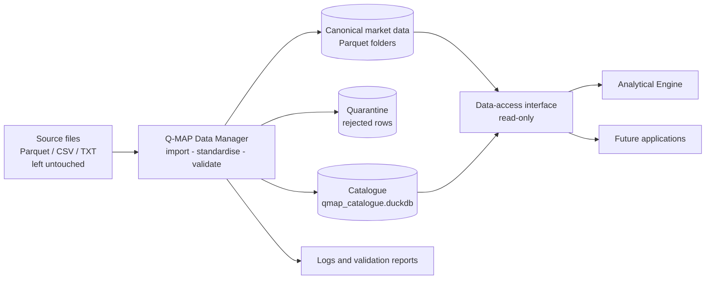
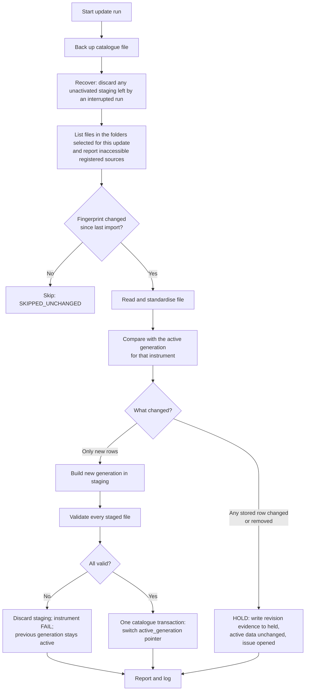

# Q-MAP — Database and Catalogue Architecture

**Package document 02 | Version 1.6 | 12-Nov-26 | Status: Proposed design — v1.6 adds the newly identified INFY G-03 cases to the expected issues (evidence correction only); pending ChatGPT review and Project Owner approval**

| Field | Value |
|---|---|
| Covers | Physical storage, dataset and instrument identification, canonical record structures, catalogue, timezone, provenance, validation, completeness, initial preparation, incremental maintenance, revisions, errors and logging, backup and recovery |
| Depends on | Human-Readable Blueprint v1.0; Technical Blueprint v1.0; Deliverable 1 v1.2 (data findings, decisions D-01 to D-13) |
| Related | 03 (data access and aggregation), 07 (decisions OD-xx, TC-xx, features F-xx) |
| Prepared by | Claude 2 |

> This package is a design and preparation deliverable. It is not approval to begin production coding.

**Status vocabulary.**
- *Approved* — a blueprint requirement or a recorded decision (D-01 to D-13).
- *Proposed* — a Claude 2 recommendation.
- *Owner decision* — needs Project Owner approval; listed as OD-xx in document 07.
- *Deferred* — not in initial scope.

Technical choices that Claude 2 made because they are not material are labelled TC-xx. They are listed in document 07 so the reviewer can check them.

**Change log**

| Version | Changed sections | Reason (review item) |
|---|---|---|
| 1.0 | — | First issue |
| 1.1 | §2.1, §2.2 | Generation-based storage per instrument (A1) |
| 1.1 | §4.1 | New quality flags for unconfirmed sessions and unverified tick rules (A3, A6) |
| 1.1 | §5.2, §5.4 | One added table, `instrument_rule`, for effective-dated tick and session rules; generation pointer; provisional completeness (A1, A3, A6, B5) |
| 1.1 | §6.2, §6.3 | Session classification, record classification and completeness separated; SPECIAL only from an official calendar or owner confirmation; counts before and after confirmation (A3, B4) |
| 1.1 | §7.1, §7.2 | V-PX-03 quarantines only when a *verified* tick rule applies; V-SES rules revised; new volume-semantics flag (A3, A4, A6) |
| 1.1 | §8 | Completeness labelled provisional while the calendar is unverified (B5) |
| 1.1 | §9.2–§9.4 | All historical revisions held for owner review; instrument-level generation commit with recovery (A1, A2) |
| 1.1 | §10 | Backup and restore with a consistency validation (B3) |
| 1.1 | §12, §13 | Reader isolation; updated limitations |
| 1.2 | §3.1 | Storage paths corrected to include the instrument folder and generation level shown in §2.1 (internal inconsistency) |
| 1.2 | §5.2 (`import_log`, `data_issue`) | Two new `import_log.action` values for duplicate and conflicting source files (G-16, proposed); continuity-blocking rule stated once (G-03 support). No new table or field. |
| 1.2 | new §5.5 | Format and meaning of the optional official calendar file (G-02 reviewer check completed; no new table or field) |
| 1.2 | §6.1 R1 | R1 accepts only data whose minimum timestamp step is 1 minute, so derived 3/5/15-minute files cannot be mistaken for 1-minute data |
| 1.2 | §6.2, §6.3 | Weekend full-length sessions (01-Feb-25, 01-Feb-26) were not covered by the session table; they are now `UNRECOGNISED_SESSION_SHAPE` until confirmed, consistent with review item A3. Expected counts updated. |
| 1.2 | §7.1 V-PX-05, §7.2 | Continuity default stated as pending Owner decision G-03, with the recommended close-based rule |
| 1.2 | §9.2 (end), §9.5 | Clarified: a held revision also holds the file's new rows, visibly; one analysis run always sees one consistent set of generations |
| 1.2 | new §9.6 | Which source files an Update examines (G-09) and how several files for one symbol are handled (G-16) |
| 1.2 | §13 | Limitations updated |
| 1.3 | §5.2 (`market_calendar`, `instrument_rule`, `data_issue`) | G-02: two provenance fields added to `market_calendar` (`evidence`, `confirmed_at`) and a new `source` value; G-04 (Owner-approved) verification rule stated on `instrument_rule`; G-03 (Owner-approved) continuity default stated on `data_issue` |
| 1.3 | §5.5 (rewritten) | G-02 (ChatGPT finding 6): importing a calendar file no longer makes it official; the Owner must first record its source |
| 1.3 | §6.1 R1 | TC-26 (ChatGPT finding 11): time-step test changed from "smallest step" to "most common step", so genuine 1-minute files with missing minutes are never rejected |
| 1.3 | §7.1 V-PX-03, V-PX-05; §7.2 | G-04 and G-03 as approved by the Owner; the open-only exception of v1.2 removed (ChatGPT finding 2) |
| 1.3 | §9.6 (rewritten) | G-16 as approved (exact SHA-256 only; differing files to the Owner; no automatic selection) and G-09 (only explicitly selected folders; inaccessible registered sources reported, never treated as deletion) — ChatGPT findings 1 and 7 |
| 1.3 | §9.2 diagram | Update starts from the explicitly selected folders (G-09) |
| 1.3 | §13 | Limitations 9 and 10 updated |
| 1.4 | §13 item 1 | Clarified that V-04 gates the pilot (M1c) and wider loads only, not Gate 0, M1a, M1b or M2 (v1.7 targeted correction) |
| 1.5 | §7.1 V-PX-05, §7.2 | Source check of CONCOR (document 13 v1.1 §4) found three further ±15% cases: 31-Jan-08 (close +15.83%), 20-Mar-20 (close +16.09%) and 10-Aug-20 (close −15.24%). Added to the examples and the expected issues; each is a G-03 blocking case awaiting the Owner's verification. No rule changed. |
| 1.6 | §7.2 | INFY source check (document 13 v1.2 §6) found seven further ±15% cases (08-Aug-00, 11-Apr-01, 18-Apr-01, 10-Apr-03, 11-Jan-13, 12-Apr-13, 22-Oct-19). Added to the expected issues as G-03 blocking cases awaiting the Owner's verification. No rule changed. |

Unchanged in v1.1: §1, §2.3, §3, §4.2–§4.5, §5.1, §5.3, §6.1, §9.5, §11.

Unchanged in v1.2: §1, §2, §3.2, §4, §5.1, §5.3, §5.4, §8, §9.1, §9.3, §9.4, §10, §11, §12.

Unchanged in v1.3: everything except the sections listed in the 1.3 rows above.

---

## 1. What the Q-MAP Database is — in plain English

The Q-MAP Database is a set of folders on your computer, plus one small catalogue file:

- **The folders** hold market data in Parquet files, cleaned into one consistent shape.
- **The catalogue file** records what data exists, where it came from, how complete it is, and which problems were found.

DuckDB is the engine that reads the Parquet files quickly when a program asks for data.

The database has two kinds of users:

1. **The Q-MAP Data Manager.** A small Windows program that imports and maintains the data. Only this program writes to the database.
2. **Readers.** The Analytical Engine and any future program. They ask for data through the data-access interface (document 03) and never touch the files directly.



**Approved requirements this satisfies:**
- Parquet plus DuckDB, local only.
- Independent of the Analytical Engine.
- Reusable by other applications.
- No rebuild when a scanner runs.
- Initial preparation and maintenance kept as separate activities.

---

## 2. Physical organisation (F-01, Proposed)

### 2.1 Data root

The user chooses one **data root** folder, for example `D:\QMAP_DATA`, with a folder picker on first use. The data root is separate from the program code and is never placed in the GitHub repository.

Every instrument's market data is stored as a series of numbered **generations**. A generation is one complete set of that instrument's files. Readers use only the generation the catalogue marks as **active** (§9.4).

```
QMAP_DATA\
├── catalogue\
│   └── qmap_catalogue.duckdb                  catalogue (the only metadata store)
├── market\
│   ├── NSE_INDEX_1M\
│   │   ├── NIFTY\
│   │   │   ├── gen_000007\                   previous complete generation (kept for recovery)
│   │   │   │   ├── NIFTY_2025.parquet
│   │   │   │   └── NIFTY_2026.parquet
│   │   │   └── gen_000008\                   ACTIVE generation (pointer held in the catalogue)
│   │   │       ├── NIFTY_2025.parquet
│   │   │       └── NIFTY_2026.parquet
│   │   └── BANKNIFTY\gen_000003\BANKNIFTY_2026.parquet
│   ├── NSE_EQ_DAILY\
│   │   ├── CONCOR\gen_000002\CONCOR.parquet
│   │   └── INFY\gen_000001\INFY.parquet
│   └── NSE_SECTOR_INDEX_DAILY\
│       └── NIFTYIT\gen_000001\NIFTYIT.parquet
├── staging\                                   generations being built; never read by readers
├── quarantine\                                rows rejected by validation, kept for review
│   └── NSE_INDEX_1M\NIFTY_imp000012.parquet
├── held\                                      revised source data held for owner review (§9.3)
│   └── NSE_EQ_DAILY\CONCOR_imp000057.parquet
├── reference\
│   └── nse_market_calendar.csv                optional official holiday / special-session list
├── backups\
│   └── catalogue\qmap_catalogue_11_Nov_26_183427.duckdb
├── reports\                                   validation reports (Excel), one per run
└── logs\                                      plain-text run logs, one per run
```

The v1.0 `versions\` folder is replaced by retained generations, which serve the same recovery purpose.

### 2.2 Why this layout (TC-02)

| Choice | Reason | Alternative considered |
|---|---|---|
| Intraday: one file per instrument per **year**, inside a generation | About 94,000 rows per instrument per year (2–4 MB). Easy to read and verify. | One file per day: thousands of tiny files |
| Daily: one file per instrument, inside a generation | Matches how the source arrives (one file per stock) | One file for all stocks: any single-stock revision rewrites everything |
| **Generations** per instrument (new in v1.1) | Makes an instrument's multi-file update all-or-nothing. A new generation is built and checked in `staging`, then activated by one catalogue transaction. Readers never see a mix of old and new files (§9.4). | Replacing files one by one with `os.replace`: each single replacement is atomic, but a set of several files is not (review item A1) |
| Unchanged files in a new generation | Hard-linked from the previous generation where Windows NTFS allows it; otherwise copied (2–4 MB per year file) | Partial generations that point back to older ones: more complex to reason about and recover |
| Separate `quarantine` and `held` areas | D-11 and the blueprint forbid silently discarding data. Rejected rows and held revisions stay visible and reviewable. | Dropping rows or overwriting history: violates "no silent failure" |

**Scale check.** The full stock universe would be about 2,000 instrument folders totalling about 280 MB per generation. Two indices over ten years at 1 minute come to about 1.9 million rows, roughly 40–80 MB. Keeping two to three generations per instrument roughly doubles to triples this, which remains small for a Windows PC.

### 2.3 Source files are not moved or copied

Q-MAP **reads** source files wherever the user keeps them. It records each file's path, size, modified time and SHA-256 fingerprint in the catalogue, and never edits, moves or deletes them. This follows the blueprint rule to preserve original source files and avoid unnecessary copies of large datasets.

Consequence: if the user later deletes a source file, its content still exists in canonical form inside Q-MAP. The fingerprint proves which file version it came from.

---

## 3. Dataset and instrument identification

### 3.1 Datasets (TC-05, Proposed)

A **dataset** is a collection of instruments that share the same structure, base timeframe and source type.

| dataset_id | Description | Base timeframe | Instruments at start | Storage |
|---|---|---|---|---|
| `NSE_INDEX_1M` | NSE index intraday candles | 1 minute | NIFTY, BANKNIFTY | `market\NSE_INDEX_1M\<INSTRUMENT>\gen_<NNNNNN>\<INSTRUMENT>_<YYYY>.parquet` |
| `NSE_EQ_DAILY` | NSE equity daily bars | 1 day | CONCOR, INFY (and further stocks) | `market\NSE_EQ_DAILY\<INSTRUMENT>\gen_<NNNNNN>\<INSTRUMENT>.parquet` |
| `NSE_SECTOR_INDEX_DAILY` | NSE sector index daily bars (D-13) | 1 day | NIFTYIT | `market\NSE_SECTOR_INDEX_DAILY\<INSTRUMENT>\gen_<NNNNNN>\<INSTRUMENT>.parquet` |

`<INSTRUMENT>` is the file-safe name (§3.2). Only the generation named by `instrument.active_generation` is ever read (§9.4).

**Difference from the blueprint.** The Technical Blueprint listed provisional IDs `NIFTY_1M`, `BANKNIFTY_1M` and `NIFTY_STOCKS_DAILY`. Grouping by structure, rather than one dataset per index, means a new index needs no new dataset. This is recorded as contradiction G-01 in document 07. It is not a scope change.

**Not loaded.** The derived Nifty 3/5/15-minute, daily and monthly files are not loaded as datasets. They are kept only as test answer keys (document 06).

### 3.2 Instruments (TC-06)

| Rule | Detail |
|---|---|
| `instrument_id` | The NSE symbol in upper case, exactly as the exchange uses it (e.g. `CONCOR`, `INFY`, `M&M`, `BAJAJ-AUTO`). Indices: `NIFTY`, `BANKNIFTY`, `NIFTYIT`. |
| File-safe name | Every character outside A–Z and 0–9 becomes `_` (e.g. `M&M` → `M_M`). The catalogue stores the actual file path. Registration is refused if two symbols would produce the same file name. |
| Source aliases | Source files do not contain a symbol column (Deliverable 1), so identity comes from the file name. The catalogue holds the file-name aliases for each instrument, e.g. `Nifty_1min*` → NIFTY, `NSE_BANKNIFTY__1*` → BANKNIFTY, `Nifty_IT` → NIFTYIT. For `NSE_EQ_DAILY`, the default rule is that the file stem equals the symbol (`CONCOR.txt` → CONCOR). |
| Unknown files | **Never guessed.** The Data Manager lists unrecognised file names and asks the user to map or register them, either one at a time or as a batch confirmation of new stock symbols. |
| Instrument type | `INDEX`, `SECTOR_INDEX` or `EQUITY` |
| Timezone | `Asia/Kolkata` for every NSE instrument |

---

## 4. Canonical record structures

"Canonical" means the single standard shape every source is converted into. Readers always see this shape, whichever vendor format the data came from.

### 4.1 Intraday 1-minute record (dataset `NSE_INDEX_1M`)

| Field | Type | Null allowed | Meaning |
|---|---|---|---|
| `instrument_id` | VARCHAR | No | e.g. `NIFTY` |
| `ts` | TIMESTAMP (microseconds, no timezone) | No | IST wall-clock **start** of the minute. For a closing-auction record, the standardised session close time (D-09). |
| `record_type` | VARCHAR | No | `CANDLE` (continuous trading), `AUCTION_PHASE` (the 15:15 record on CAS days, D-10) or `CLOSING_AUCTION` (the final auction or closing print, D-08/D-09) |
| `open`, `high`, `low`, `close` | DOUBLE | No | Prices as supplied — never adjusted by Q-MAP |
| `volume` | BIGINT | **Yes** | Missing is normal and not an error (D-03) |
| `source_ts` | TIMESTAMP | No | Timestamp exactly as it appeared in the source file. **Mandatory under D-09.** For an auction print received at 15:29 and standardised to 15:30, `ts` = 15:30 and `source_ts` = 15:29. |
| `quality_flags` | VARCHAR | Yes | Semicolon list of flags for stored-but-noteworthy rows. Empty for normal rows. Flags: `SUSPECT_FILL` (constant-step heuristic); `OFF_TICK_RULE_UNVERIFIED` (off-tick value where no verified tick rule exists); `SESSION_UNCONFIRMED` (day shape not matched to an official or owner-confirmed session); `CAS_CANDIDATE` (CAS pattern detected, not yet confirmed); `SESSION_CLOSE_UNVERIFIED`; `VOLUME_SEMANTICS_UNVERIFIED` (volume on an auction record whose meaning is not established, DQ-21). |
| `import_id` | INTEGER | No | Link to the catalogue `import_log` row, which records the source file, its fingerprint and the run. This is the provenance chain. |

**Unique key:** (`instrument_id`, `ts`). Moving the auction print to 15:30 cannot clash with a candle:
- CAS days have no candles after 15:14.
- Non-CAS days end at the 15:29 candle.

### 4.2 Daily record (datasets `NSE_EQ_DAILY`, `NSE_SECTOR_INDEX_DAILY`)

| Field | Type | Null allowed | Meaning |
|---|---|---|---|
| `instrument_id` | VARCHAR | No | |
| `trade_date` | DATE | No | Exchange trading date |
| `open`, `high`, `low`, `close` | DOUBLE | No | As supplied |
| `volume` | BIGINT | Yes | Field 6 of text files (D-01) |
| `quality_flags` | VARCHAR | Yes | e.g. `LARGE_GAP_UNVERIFIED`, `LEVEL_BREAK_UNVERIFIED` |
| `import_id` | INTEGER | No | Provenance link |

**Unique key:** (`instrument_id`, `trade_date`).

### 4.3 Fields deliberately not stored

| Not stored | Reason | Decision |
|---|---|---|
| Indicator columns (Pivot, CPR, Camarilla, ATR, Plot, vendor `Net Volume`) | Derived values with mixed methods | D-12 (Approved) |
| Field 7 of text files when equal to Volume | Duplicate | D-01 (Approved) |
| Net volume (field 7 when lower than Volume) | Optional, not available everywhere, "not structured data" | D-02 (Approved). Optional extras store is P2 — OD-08. |

Unknown extra columns are ignored and listed once in the import report as INFO, so nothing disappears unnoticed.

### 4.4 Quarantine record

Rows that fail validation are written to `quarantine\<dataset>\<instrument>_imp<import_id>.parquet`. Each row carries:
- the original values as read,
- the source row number,
- the `import_id`,
- a `reason_code` (section 7).

The user can inspect quarantined rows. The design has no automatic route back into canonical data: a corrected source file must be supplied instead.

### 4.5 Timezone and timestamp representation (TC-03, Proposed)

**What is stored:**
- Timestamps are stored **without a timezone**, as IST wall-clock values, with the timezone **declared** in the catalogue (`dataset.timezone = 'Asia/Kolkata'`).
- Precision is microseconds. The source data is whole minutes, so converting from the master's nanoseconds loses nothing.

**Why naive rather than timezone-aware:**
- DuckDB displays timezone-aware timestamps in the computer's session timezone. On a Windows PC that setting can silently shift every displayed time.
- Naive IST plus a declared timezone is what every inspected source except one already uses. It is impossible to shift by accident.

**On import:**
- A source time with an explicit offset (the Bank Nifty CSV, `+05:30`) is checked. Any offset other than `+05:30` is rejected as an error. The offset is then removed.
- A source time without an offset is taken as IST, because the dataset declares it.
- Q-MAP **never** relies on the computer's local timezone setting.

The data-access interface returns the timezone and the "interval start" meaning in every response (document 03).

---

## 5. The catalogue (F-02)

### 5.1 Storage choice (TC-01, Proposed)

The catalogue is **one DuckDB database file** that holds only metadata, never market data.

| Option | Assessment |
|---|---|
| **DuckDB file (recommended)** | Already a project dependency. Safe multi-table updates in one transaction (all-or-nothing). Queried with the same SQL as the market data. One file to back up. |
| JSON or CSV files | Readable in Notepad or Excel, but there is no all-or-nothing update across several files. A crash mid-update can leave the catalogue inconsistent, and querying needs extra code. |
| SQLite | Not needed. DuckDB already provides everything required. The blueprint forbids SQLite without a demonstrated need, and none exists. |
| Parquet tables | Every small change would rewrite a file, with no transactions. |

No parallel metadata store is created. The one exception is configuration: user-editable *settings* (data root path, scoring profiles) live in small JSON files under the program's `config` folder. These are inputs, not database state.

### 5.2 Catalogue tables

Each table exists because it answers a question the blueprint requires the catalogue to answer.

| # | Table | Question it answers | Key fields |
|---|---|---|---|
| 1 | `dataset` | Which datasets exist? | dataset_id, name, data_kind (`intraday_ohlcv` / `daily_ohlcv`), base_timeframe, storage_folder, timezone, provenance_note, status |
| 2 | `instrument` | Which instruments exist, how are source files recognised, which generation is active? | instrument_id, dataset_id, display_name, instrument_type, exchange, file_safe_name, source_aliases (list), active, **active_generation**, **previous_generation** |
| 3 | `field_definition` | Which fields are available? | dataset_id, field_name, data_type, nullable, unit, meaning |
| 4 | `coverage` | Which date ranges, latest records, update and quality status? | dataset_id, instrument_id, generation, first_ts, last_ts, trading_days, row_count, volume_first_date, volume_last_date, last_import_id, last_update_at, last_validated_at, quality_status, completeness_status, completeness_basis (`OFFICIAL_CALENDAR` / `PROVISIONAL_DERIVED_CALENDAR`), open_warning_count, open_error_count |
| 5 | `day_profile` | Completeness and session status per intraday day | instrument_id, trade_date, generation, observed_shape (`REGULAR_SHAPE` / `CAS_SHAPE` / `OTHER`), session_status (`CONFIRMED_OFFICIAL` / `CONFIRMED_BY_OWNER` / `CANDIDATE` / `UNRECOGNISED_SESSION_SHAPE`), session_type (`REGULAR` / `CAS` / `SPECIAL` / `SPECIAL_CAS`, null while unrecognised), first_record, last_continuous_candle, expected_candles, expected_basis, present_candles, missing_candles, missing_ranges, has_auction_phase, has_closing_auction, has_volume, quarantined_rows |
| 6 | `market_calendar` | Is a date a trading day, holiday or special session? | trade_date, day_type (`TRADING` / `HOLIDAY` / `SPECIAL`), session_open, session_close, description, source (`DERIVED_FROM_DATA` / `REFERENCE_FILE_UNCONFIRMED` / `OFFICIAL_REFERENCE` / `USER`), verified, **evidence**, **confirmed_at** (the last two added in v1.3 for G-02; see §5.5) |
| 7 | `data_file` | Which physical files make up each generation? (used for integrity checks and recovery) | relative_path, dataset_id, instrument_id, **generation**, period, row_count, min_ts, max_ts, sha256, written_at, written_by_run |
| 8 | `import_log` | Where did each row come from? | import_id, run_id, source_path, source_name, source_size, source_modified, source_sha256, reader_used, dataset_id, instrument_id, rows_read, rows_stored, rows_quarantined, rows_new, rows_changed, rows_removed, action (`NEW` / `APPEND` / `HELD_REVISION` / `APPLIED_APPROVED_REVISION` / `REJECTED_REVISION` / `SKIPPED_UNCHANGED` / `DUPLICATE_SOURCE` / `SOURCE_CONFLICT` / `FAILED`), message. The two values added in v1.2 are explained in §9.6. |
| 9 | `maintenance_run` | What was done and when? | run_id, run_type (`INITIAL` / `INCREMENTAL` / `REVALIDATE` / `APPLY_APPROVED_REVISION` / `RESTORE`), started_at, finished_at, status, files_examined, summary, report_path, log_path, catalogue_backup_path |
| 10 | `data_issue` | Which problems are known, and what was decided about them? | issue_id, dataset_id, instrument_id, ts_from, ts_to, check_code, severity (`ERROR` / `WARNING` / `INFO`), description, evidence, affects_continuity, status (`OPEN` / `ACKNOWLEDGED` / `VERIFIED_OK` / `RESOLVED`), first_seen_run, last_seen_run, user_note. **Continuity rule (v1.2):** `affects_continuity` is the single field that decides whether an issue blocks continuity-dependent calculations (rule SC-07). When the owner marks an issue `VERIFIED_OK` (a genuine market move), the Data Manager sets `affects_continuity = false` in the same transaction; when the owner confirms a real break or error, `affects_continuity` stays `true` and the status becomes `ACKNOWLEDGED`. **G-03 (Owner-approved 11-Nov-26):** every new V-PX-05 issue (open **or** close beyond ±15%) is created with `affects_continuity = true`; only the Owner, after personally verifying that occurrence, marks it `VERIFIED_OK`. |
| 11 | `instrument_rule` *(new in v1.1)* | Which effective-dated rules apply to an instrument, and are they verified? | instrument_id, rule_type (`TICK_SIZE` / `SESSION_PATTERN`), value (e.g. `0.05`, `CAS`), effective_from, effective_to, verified (true/false), source (`OFFICIAL_REFERENCE` / `OWNER_CONFIRMED` / `OBSERVED_IN_DATA`), evidence, confirmed_at. **Verification rule (G-04, Owner-approved 11-Nov-26):** `verified` may be set `true` only when `evidence` (the supporting source or observation), `effective_from` and `confirmed_at` (with who confirmed it) are all recorded, and `effective_to` is recorded where known. A row missing any of these stays `verified = false`, whatever its `source`. |

**Why one table was added (review items A3, A6).** Tick sizes and session patterns must be instrument-specific, effective-dated and marked as verified or not. No existing table can hold an effective-dated rule without overloading its meaning. The table is small: a few rows per instrument. No other tables were added. The v1.0 per-file versions are now covered by `data_file.generation`.

**Simpler alternative considered.** Three tables (datasets, coverage, issues) would cover listing and status. They would not provide provenance (blueprint), per-day completeness (assignment), session confirmation (D-06), verified rules (review A6) or recovery to a complete previous generation (review A1).

### 5.3 How the required catalogue questions are answered

| Requirement | Answered from |
|---|---|
| Available datasets and instruments | `dataset`, `instrument` |
| Available fields | `field_definition` |
| Available timeframes | `dataset.base_timeframe` plus the aggregation table in document 03 (derived timeframes are computed, not stored) |
| Date ranges and latest records | `coverage.first_ts`, `coverage.last_ts` |
| Last update status | `coverage.last_update_at`, `import_log`, `maintenance_run` |
| Data-quality and completeness status | `coverage.quality_status`, `completeness_status`, `day_profile`, `data_issue` |
| Volume availability | `coverage.volume_first_date` / `volume_last_date`, `day_profile.has_volume` |

### 5.4 Status values

| Field | Values | Rule |
|---|---|---|
| `quality_status` | `UNVALIDATED`, `PASS`, `PASS_WITH_WARNINGS`, `FAIL` | `FAIL` means the latest update for that instrument was not activated because of a blocking ERROR. The previous active generation remains readable. `PASS_WITH_WARNINGS` means data is usable, with open WARNING issues, held revisions or unconfirmed sessions. |
| `completeness_status` | `COMPLETE`, `GAPS_REPORTED`, `UNKNOWN` | `GAPS_REPORTED` if any missing candle or missing trading day exists in the stored range. |
| `completeness_basis` | `OFFICIAL_CALENDAR`, `PROVISIONAL_DERIVED_CALENDAR` | **Provisional** whenever any calendar day in the range is unverified. Until an official NSE calendar file is loaded, every completeness result is provisional (review item B5). The data-access interface returns this basis with every response. |

### 5.5 Optional official calendar file (rewritten in v1.3; G-02)

The owner may supply a holiday and special-session list as `reference\nse_market_calendar.csv`. It fills the existing `market_calendar` table. **Importing the file never, by itself, makes it official** (ChatGPT review finding 6).

**Columns of the file**

| CSV column | Maps to `market_calendar` field | Format and rule |
|---|---|---|
| `trade_date` | `trade_date` | `YYYY-MM-DD`. Two-digit years are rejected, because the history reaches back to 1998 and `98` would be ambiguous. |
| `day_type` | `day_type` | `TRADING`, `HOLIDAY` or `SPECIAL` |
| `session_open` | `session_open` | `HH:MM`, IST. Required for `SPECIAL`; blank for `HOLIDAY`; optional for `TRADING` (blank means the normal session) |
| `session_close` | `session_close` | `HH:MM`, IST. The official session close, which is also the time a closing-auction record is stamped with (D-09). Required for `SPECIAL`. |
| `description` | `description` | Free text, e.g. "Muhurat trading" |

**Two steps: import, then provenance**

| Step | Who | What is recorded | Effect |
|---|---|---|---|
| 1. Import | Data Manager, when the Owner picks the file | Rows stored with `source = REFERENCE_FILE_UNCONFIRMED`, `verified = false`; the file's path and SHA-256 in `import_log` | **None** on session status or completeness. The rows are shown to the Owner beside the derived calendar so differences are visible. |
| 2. Record provenance | The Owner, in the Data Manager | For the years the Owner confirms: `evidence` = the official source (publisher, document or circular reference and its date, as the Owner states it) plus the file's SHA-256; `confirmed_at` = date and who confirmed | Only now: `source = OFFICIAL_REFERENCE`, `verified = true` for those years. Completeness for those years becomes `OFFICIAL_CALENDAR`; matching days become `CONFIRMED_OFFICIAL` at the next re-validation. |

If the file's content changes later (new SHA-256), its rows return to `REFERENCE_FILE_UNCONFIRMED` until provenance is recorded again. No new table is introduced; `evidence` and `confirmed_at` mirror the fields already used for `instrument_rule` (G-04).

**Coverage rule.** NSE publishes holiday lists, not lists of trading days, so the file needs to list only holidays and special sessions. Every calendar **year** that appears in the file, and whose provenance the Owner has recorded, is treated as fully covered: a weekday not listed is a trading day; a weekend day not listed is a non-trading day. Other years stay on the derived, unverified calendar.

**How session times are read.** `session_open` is the first continuous-trading minute. For an instrument without a CAS rule, continuous trading runs until `session_close`. For an instrument whose verified or confirmed `SESSION_PATTERN` rule is CAS on that date, continuous trading ends 15 minutes before `session_close` (on a regular CAS day, 15:30 − 15 = 15:15, matching D-04). Checked against the two inspected special sessions: Muhurat 21-Oct-25 (13:45–14:45, pre-CAS) gives candles 13:45–14:44 and a print at 14:45; Muhurat 08-Nov-26 (BANKNIFTY, CAS-style) would need `session_close = 15:30`, giving candles 14:20–15:14 and auction records after them.

**Import checks.** A malformed date or time, an unknown `day_type`, a `SPECIAL` row without times, or the same date twice is a file-level ERROR: the file is not loaded and the reason is shown. After provenance is recorded, a covered-year weekday that the file treats as trading but on which no instrument has data is a WARNING for the Owner; nothing is changed automatically.

---

## 6. Import and standardisation

### 6.1 Source readers (F-03, Proposed)

Four readers cover every inspected format. A file is matched to a reader by its structure, **not** by trusting its name.

| Reader | Source format (as inspected) | Detection | Notes |
|---|---|---|---|
| R1 | Master-style 1-minute Parquet: `datetime` plus lower-case OHLC, optional `Volume`, optional indicator columns | Parquet containing a `datetime` timestamp and OHLC columns at 1-minute resolution, established by the **resolution test** below (revised in v1.3) | Indicator columns ignored (D-12) |
| R2 | Vendor 1-minute CSV with header: `time` in ISO 8601 with `+05:30` | CSV header containing `time`, `open`, `high`, `low`, `close` | Offset must be `+05:30`. Plot, ATR and `Net Volume` ignored (D-12). |
| R3 | Headerless daily text: `YYYY-MM-DD,O,H,L,C,Volume[,field7]`, 6 **or** 7 fields, CRLF or LF | First field parses as a date; 6–7 numeric fields | Field 7 handled per D-01/D-02 |
| R4 | Daily Parquet: `datetime` (time 00:00) plus OHLC and `Volume` | Parquet with a daily timestamp | |

Column names are matched without regard to letter case (`Volume` = `volume`). A missing required price column is a file-level **ERROR**: the file is not imported, and the reason is reported.

**Resolution test for R1 and R2 (revised in v1.3; TC-26).** The v1.2 rule used the *smallest* gap between consecutive timestamps. Missing minutes only make gaps *larger*, so that rule never rejected a genuine 1-minute file because of gaps; but it could be fooled the other way and gave no answer for a day with a single record. v1.3 uses the **most common** gap, which is stable whether or not minutes are missing:

1. Every timestamp must lie on a whole minute (otherwise V-TS-02 applies to that row).
2. Take all gaps between consecutive records **within the same day** (gaps across days are ignored, so overnight breaks, holidays, CAS jumps such as 15:14 → 15:30, and missing minutes do not matter).
3. The file is 1-minute data when the **most common within-day gap is exactly 1 minute** and at least 30 within-day gaps exist. Example: the BANKNIFTY sample, which has missing minutes (19-Aug-26 13:28–13:29) and CAS jumps, passes.
4. A file whose most common gap is 3, 5, 15 minutes or more (e.g. the owner's derived Nifty files) is **not** 1-minute data: file-level ERROR "most common time step is N minutes; 1-minute data required"; nothing imported.
5. A file with fewer than 30 within-day gaps (for example, only one record per day) cannot be classified: file-level ERROR "cannot establish 1-minute resolution" — reported to the Owner, never guessed.
6. Within an accepted file, a day with at least 10 records whose most common gap is 2 minutes or more is kept unchanged but opens a WARNING issue `RESOLUTION_SUSPECT` for that day (a day of coarser data inside a 1-minute file). Nothing is resampled or deleted.

Tests: T-FILE-06 to T-FILE-09 (document 06 v1.3).

### 6.2 Standardisation steps for intraday data (F-04)

Version 1.1 separates three steps that v1.0 combined (review item A3):
- **Session classification:** what kind of trading day this was.
- **Record classification:** what each record is.
- **Completeness validation:** what is missing.

A record's observed first and last times are **never** taken as proof of official session times, because a truncated source file can look exactly like a short special session.

**Step 1 — Read and convert time** (section 4.5). Reject the file if any timestamp fails to parse; quarantine rows whose seconds are not `:00` (V-TS-01, V-TS-02).

**Step 2 — Duplicates (TC-07).**
- Exact duplicates are collapsed to one row with an INFO note.
- Conflicting duplicates are **all** quarantined (`DUPLICATE_CONFLICT`), and that minute is reported as missing.

**Step 3 — Session classification (per instrument, per day).**

First, the day's **observed shape** is recorded:

| Observed shape | Rule |
|---|---|
| `REGULAR_SHAPE` | First record 09:15; continuous records to 15:29; nothing after 15:29 |
| `CAS_SHAPE` | First record 09:15; a 15:14 record; nothing between 15:16 and 15:27; last record (at or after 15:15) flat |
| `OTHER` | Anything else, including a late start, an early end, or a short session |

Then the **session status and type** are assigned from authoritative sources only:

| Situation | `session_status` | `session_type` |
|---|---|---|
| `market_calendar` has a verified official entry for the date (regular, holiday or special, with times) and the instrument's verified `SESSION_PATTERN` rule is consistent with it | `CONFIRMED_OFFICIAL` | From the calendar and rule: `REGULAR`, `CAS`, `SPECIAL` or `SPECIAL_CAS` |
| The owner has explicitly confirmed the day, or a CAS pattern rule covering the date (D-06) | `CONFIRMED_BY_OWNER` | As confirmed |
| `REGULAR_SHAPE` on a weekday not marked as a holiday | `CANDIDATE` | `REGULAR` (provisional) |
| `REGULAR_SHAPE` or `CAS_SHAPE` on a **Saturday or Sunday** (e.g. Budget-day sessions 01-Feb-25 and 01-Feb-26), with no official calendar entry and no owner confirmation (new row in v1.2) | **`UNRECOGNISED_SESSION_SHAPE`** | null |
| `CAS_SHAPE` on or after 03-Aug-26 | `CANDIDATE` | `CAS` (provisional; D-06 confirmation pending) |
| `OTHER`, with no official calendar entry and no owner confirmation | **`UNRECOGNISED_SESSION_SHAPE`** | null |

**The key rule (review item A3):** a day is classified `SPECIAL` or `SPECIAL_CAS` **only** when an official calendar entry or an explicit owner confirmation says so. A late first record or an early last record never creates a special session by itself. Example: Muhurat 21-Oct-25 (NIFTY) and 08-Nov-26 (BANKNIFTY) both remain `UNRECOGNISED_SESSION_SHAPE` until the official calendar file lists them or the owner confirms them. A weekend session is by definition a special session, so a full-length weekend day is treated the same way (v1.2). A calendar row derived from the data (`source = DERIVED_FROM_DATA`, `verified = false`) never confirms a session; only an `OFFICIAL_REFERENCE` row or an owner confirmation (`USER`) does.

The Data Manager presents two confirmation lists:
1. Detected CAS candidates, as in "NIFTY: CAS shape on 67 days from 03-Aug-26 to 06-Nov-26 — confirm?".
2. Unrecognised days, as in "NIFTY 21-Oct-25: records 13:45–14:45 only. Special session, or truncated data?".

The owner's answer is stored as an `instrument_rule` (`SESSION_PATTERN`, `OWNER_CONFIRMED`) or as a calendar entry (`USER`).

**Step 4 — Record classification.**

| Day status | Record classification |
|---|---|
| `CONFIRMED_*` or `CANDIDATE`, type `REGULAR` | All records `CANDLE` |
| `CONFIRMED_*` or `CANDIDATE`, type `CAS` / `SPECIAL_CAS` | Continuous records → `CANDLE`; the 15:15 record → `AUCTION_PHASE` (D-10); the final flat print → `CLOSING_AUCTION` (D-08). Candidate days also carry the flag `CAS_CANDIDATE`. |
| `CONFIRMED_*`, type `SPECIAL` | Continuous records → `CANDLE`; a final flat print after them → `CLOSING_AUCTION` |
| `UNRECOGNISED_SESSION_SHAPE` | **All observed records retained** as `CANDLE` with the flag `SESSION_UNCONFIRMED`. Nothing is quarantined, re-stamped or labelled as an auction. |

When an unrecognised day is later confirmed, a `REVALIDATE` run re-classifies its records in a new generation (§9.4).

**Step 5 — Closing-auction time (D-09).** For a `CLOSING_AUCTION` record:
- set `ts` to the official session close from a **verified** calendar entry, or to 15:30 for a regular trading day under the confirmed or candidate CAS rule (D-04);
- keep the original time in `source_ts` (mandatory);
- for confirmed special sessions without a verified official close, keep `ts = source_ts` and add `SESSION_CLOSE_UNVERIFIED`. Special-session close times stay unverified until official reference data exists (review item B4).

**Step 6 — Validate** (section 7). **Step 7 — Merge with stored data** (section 9).

**Completeness validation** happens separately, after the steps above (section 8). Its expectations come from the session status, never from the observed records alone.

**Daily data** follows steps 1, 2, 6 and 7; there is no session classification. Field 7 is read and ignored per D-01; the extras store is P2 (OD-08).

### 6.3 Worked example — Bank Nifty 18-Aug-26 (actual records)

| Source time | O | H | L | C | Volume | Stored `ts` | `record_type` | `source_ts` |
|---|---:|---:|---:|---:|---:|---|---|---|
| 15:14 | 57,337.40 | 57,337.40 | 57,291.90 | 57,324.95 | 993,133 | 15:14 | CANDLE | 15:14 |
| 15:15 | 57,314.55 | 57,314.55 | 57,308.15 | 57,308.15 | 19,993 | 15:15 | AUCTION_PHASE | 15:15 |
| 15:29 | 57,262.40 | 57,262.40 | 57,262.40 | 57,262.40 | 19,993 | **15:30** | CLOSING_AUCTION | **15:29** |

Because 18-Aug-26 is a CAS **candidate** until the owner confirms the CAS rule (D-06), all records of the day also carry the flag `CAS_CANDIDATE`. The two auction records additionally carry `VOLUME_SEMANTICS_UNVERIFIED`: their identical 19,993 volumes may be a duplicate (Deliverable 1 v1.2, §6.5).

**Expected counts after importing the inspected samples** (acceptance figures for M1). Counts depend on confirmation status, because unrecognised special sessions are not given auction labels until confirmed:

| Instrument | Source rows | State | CANDLE | AUCTION_PHASE | CLOSING_AUCTION | Quarantined |
|---|---:|---|---:|---:|---:|---:|
| NIFTY (09-Jan-25 to 06-Nov-26) | 168,623 | Before confirmation of the three special sessions | 168,556, of which **811** are flagged `SESSION_UNCONFIRMED` (61 on 21-Oct-25; 375 each on 01-Feb-25 and 01-Feb-26) | 0 | 67 (CAS candidates) | 0 |
| NIFTY | 168,623 | After the owner confirms 21-Oct-25 (13:45–14:45) and the two Budget-day sessions (09:15–15:30) as special sessions | 168,555 (none flagged `SESSION_UNCONFIRMED`) | 0 | 68 | 0 |
| BANKNIFTY (17-Aug-26 to 11-Nov-26) | 21,396 | Before confirmation of 08-Nov-26 | 21,295 (57 flagged `SESSION_UNCONFIRMED` on 08-Nov-26) | 42 | 59 | 0 |
| BANKNIFTY | 21,396 | After the owner confirms 08-Nov-26 as a special session with CAS ending | 21,293 | 43 | 60 | 0 |

Session status after the first import (corrected in v1.2): NIFTY **383** `CANDIDATE` REGULAR, 67 `CANDIDATE` CAS, **3** `UNRECOGNISED_SESSION_SHAPE` (21-Oct-25, 01-Feb-25, 01-Feb-26). BANKNIFTY 59 `CANDIDATE` CAS, 1 `UNRECOGNISED_SESSION_SHAPE` (08-Nov-26). The record counts are unchanged from v1.1, because unrecognised days keep all their records as `CANDLE`; only the flags differ.

*Basis of the correction:* Deliverable 1 v1.2 §9.4 lists 01-Feb-25 (Saturday) and 01-Feb-26 (Sunday) as full regular-length sessions inside the NIFTY sample. v1.1 counted them among the 385 regular days, although its own session table admits candidate REGULAR days only on weekdays. The counts above follow from that evidence (453 days = 383 + 67 + 3); they have not been re-run on the files, which are not available in this workspace.

---

## 7. Validation and quality status (F-05)

### 7.1 Validation checks

Severity determines what happens to the data:

| Severity | What happens |
|---|---|
| **ERROR** | The row is quarantined, or the update is held |
| **WARNING** | The row is stored, possibly flagged, and an issue is opened |
| **INFO** | Recorded only |

| Code | Check | Applies to | Severity and action |
|---|---|---|---|
| V-FILE-01 | File readable, complete, recognised by a reader | All | ERROR: file not imported |
| V-SCH-01 | Required columns present (time, O, H, L, C) | All | ERROR: file not imported |
| V-SCH-02 | Unexpected columns | All | INFO: listed, ignored |
| V-TS-01 | Timestamp parses; offset is +05:30 when present | All | ERROR: file not imported |
| V-TS-02 | Intraday timestamps on whole minutes | Intraday | ERROR: row quarantined (`BAD_TIMESTAMP`) |
| V-TS-03 | Duplicate key: exact or conflicting | All | INFO (exact, collapsed) / ERROR (conflict, all copies quarantined) |
| V-PX-01 | OHLC relationship (High ≥ max(O, C, L); Low ≤ min(O, C, H)) | All | ERROR: row quarantined (`INVALID_OHLC`). Example: Nifty IT 01-Jul-05. |
| V-PX-02 | Prices positive and finite | All | ERROR: quarantined |
| V-PX-03 | Price on the instrument's tick grid | Only where `instrument_rule` holds a `TICK_SIZE` rule for that instrument and date. Never applied to back-adjusted daily stock history (TC-20). | **Verified rule** (`verified = true`): off-tick row → ERROR, quarantined (`OFF_TICK_SYNTHETIC`), per D-11. **Rule observed but not verified** (`OBSERVED_IN_DATA`), or no rule: off-tick row → WARNING, stored with `OFF_TICK_RULE_UNVERIFIED`, issue opened for review. **Not quarantined.** (Review item A6; OD-05.) For the indices, the 0.05 grid is so far only *observed* (Deliverable 1 v1.2, §4). A rule counts as verified only under the G-04 rule in §5.2 (Owner-approved). |
| V-PX-04 | Constant-step run: three or more consecutive candles with an identical close-to-close step and frozen High/Low | Intraday | WARNING only: stored with `SUSPECT_FILL` and an issue opened. **Never quarantined automatically**, because it is a heuristic (OD-05). Closes the gap noted in DQ-02. |
| V-PX-05 | Day-to-day open or close change beyond ±15% | Daily | WARNING: stored unchanged with `LARGE_GAP_UNVERIFIED` and an issue opened with **`affects_continuity = true`** (G-03, Owner-approved): it blocks continuity-dependent calculations until the Owner verifies that occurrence and marks it `VERIFIED_OK`. This applies equally to open and close moves. The issue records the open and close percentages for the Owner's review. Examples: CONCOR 06-Sep-13, Nifty IT 28-May-04, CONCOR 04-Jun-24, CONCOR 26-May-04, and the newly identified CONCOR 31-Jan-08 (close +15.83%), 20-Mar-20 (close +16.09%) and 10-Aug-20 (close −15.24%). *(A separate, unapproved proposal to treat open-only moves differently is recorded as P-01 in document 12; it is not part of this design.)* |
| V-VOL-01 | Volume negative or non-whole | All | ERROR: quarantined |
| V-VOL-02 | Volume missing | All | Not an issue (D-03). Coverage records the volume dates instead. |
| V-VOL-03 | Volume present on an `AUCTION_PHASE` or `CLOSING_AUCTION` record | Intraday | Stored as supplied with flag `VOLUME_SEMANTICS_UNVERIFIED`; one INFO issue per instrument (DQ-21). Excluded from daily volume (document 03 v1.1, §B7). |
| V-SES-01 | Session classification (6.2 step 3) | Intraday | WARNING `UNRECOGNISED_SESSION_SHAPE` (records retained and flagged; possible missing data reported). INFO for each CAS candidate awaiting confirmation. |
| V-SES-02 | Missing candles inside a continuous session | Intraday | WARNING: listed in `day_profile` and grouped into one issue per day |
| V-SES-03 | Records outside a **confirmed** session (e.g. after 15:29 on a `CONFIRMED_OFFICIAL` regular day) | Intraday | ERROR: quarantined (`OUTSIDE_SESSION`). On candidate or unrecognised days, the day is treated as `UNRECOGNISED_SESSION_SHAPE` instead (nothing quarantined). |
| V-CAL-01 | Weekday with no data for any instrument | Calendar | INFO: candidate holiday (`DERIVED_FROM_DATA`, `verified = false`) |
| V-CAL-02 | Trading day (per calendar) missing for one instrument inside its own date range | All | WARNING: `MISSING_DAY` (may be a stock suspension) |
| V-CAL-03 | Data on a calendar HOLIDAY marked `verified = true` | All | WARNING: conflict between data and official calendar |
| V-REV-01 | Stored history changed or removed by a newer source file | All | WARNING: revision **held** for owner review (section 9.3) |
| V-INT-01 | Physical file matches the catalogue (row count, SHA-256) | All | ERROR: integrity mismatch, offers restore (section 10) |

### 7.2 Known Deliverable 1 findings and how the design represents them

| Finding | Representation in the database |
|---|---|
| DQ-01/02 Interpolated candles (2023–24, confirmed in derived files, inferred in master) | V-PX-03: off-tick rows flagged (`OFF_TICK_RULE_UNVERIFIED`) until the tick rule is verified, then quarantined. V-PX-04 flags on-tick constant-step runs. Resulting gaps reported. |
| DQ-12 Back-adjustment (working hypothesis) | No automatic adjustment. Every history revision is held for owner review (section 9.3). |
| DQ-13/14 CONCOR suspicious records, plus three cases found in the v1.9 source check | V-PX-05 issues, `status = OPEN`, `affects_continuity = true` for every one — CONCOR 26-May-04, 27-May-04, 15-May-06, **31-Jan-08**, 06-Sep-13, **20-Mar-20**, **10-Aug-20**, 04-Jun-24; INFY **08-Aug-00, 11-Apr-01, 18-Apr-01, 10-Apr-03**, 24-Oct-03, **11-Jan-13, 12-Apr-13, 22-Oct-19** (bold: found in the v1.10 source check) — until the Owner verifies each and marks it `VERIFIED_OK` (G-03). None is classified, quarantined or unblocked automatically. |
| DQ-15 Nifty IT 28-May-04 level break (unverified) | Issue `LEVEL_BREAK_UNVERIFIED` with `affects_continuity = true`. Returned to callers whose range spans the date. Scanners must not compute returns across it (document 04, rule SC-07). |
| DQ-16 Nifty IT invalid open 01-Jul-05 | Quarantined (V-PX-01). That trading day is therefore reported missing for NIFTYIT. |
| DQ-18/19 Holidays and special sessions unverified | `market_calendar.verified = false`; completeness basis `PROVISIONAL_DERIVED_CALENDAR`; special sessions only via official entry or owner confirmation |
| DQ-21 Auction-record volume semantics (new) | V-VOL-03 flag; auction volumes excluded from daily volume |
| C-5 Auction print vs official close | A pending-verification item. Automated comparison is P2, once an official close file is available (document 07). |

---

## 8. Completeness tracking

Completeness is measured, never assumed. It is a separate step from session and record classification (§6.2).

- **Intraday, per instrument per day** (`day_profile`): expected candles, with their basis recorded in `expected_basis`:

  | Session status | Expected candles | `expected_basis` |
  |---|---|---|
  | Confirmed REGULAR / CAS | 375 / 360 (plus auction records for CAS) | `CONFIRMED_SESSION` |
  | Candidate REGULAR / CAS | 375 / 360 | `CANDIDATE_SESSION` (provisional) |
  | Confirmed SPECIAL | From the verified calendar session times; if times are unverified, from the owner-confirmed times | `CONFIRMED_SESSION` |
  | `UNRECOGNISED_SESSION_SHAPE` on a weekday not marked as a holiday | The regular session (09:15–15:29, or 09:15–15:14 if a CAS rule covers the date), as a **provisional** expectation. Records outside it are retained, not counted as missing. | `PROVISIONAL_REGULAR_ASSUMPTION` |

  Present candles and missing ranges (e.g. `13:28-13:29`) are recorded against that expectation.
- **Daily, per instrument:** trading days expected from `market_calendar` between the instrument's first and last date, compared with the days present.
- **Roll-up:** `coverage.completeness_status`, plus `completeness_basis`.

**Completeness is provisional until the official calendar is verified** (review item B5). Every report, catalogue roll-up and data-access response states `PROVISIONAL_DERIVED_CALENDAR` until an official NSE calendar has been loaded for the dates concerned.

**Examples from the inspected data:**
- BANKNIFTY on 19-Aug-26 is a CAS candidate with 360 expected candles and 358 present. Its missing range is `13:28-13:29`.
- **Truncated-day example.** A regular weekday whose file stops at 12:00 has shape `OTHER` and status `UNRECOGNISED_SESSION_SHAPE`. Expected candles are 375 (`PROVISIONAL_REGULAR_ASSUMPTION`), present 165, and the missing range is reported as `12:00-15:29`, labelled "possible missing data". It is **not** treated as a special session.
- **Muhurat 21-Oct-25 before confirmation.** Reported in the same way, with "possible missing data 09:15-13:44 and 14:46-15:29" and a request for confirmation. After the owner confirms it as a special session (13:45–14:45), expected candles become 60 and nothing is missing.

Holidays are never counted as missing. Before an official calendar is loaded, holidays are *derived*: a weekday with no data in **any** instrument, marked `verified = false`.

---

## 9. Initial preparation and incremental maintenance

### 9.1 Two separate activities (Approved — blueprint)

| | Initial preparation | Incremental maintenance |
|---|---|---|
| When | Once per dataset, or when the user deliberately rebuilds | Routinely, e.g. after new daily data arrives |
| Started by | Data Manager → "Initial load" | Data Manager → "Update" |
| What it does | Creates the data root and catalogue, registers datasets and instruments, loads the optional calendar file, imports full history, validates, builds profiles and coverage, writes the first report | Finds changed source files, imports only what is new, detects revisions, validates the affected ranges, writes a report |
| Never triggered by | Scanner runs, the Analysis Runner, the data-access interface | Same |

### 9.2 Incremental update flow (F-10)



**Change detection.**
- A source file is examined only if its SHA-256 fingerprint differs from the last import.
- If it has changed, its **whole overlapping range** is compared with the active generation by key. Each row is classed as NEW, UNCHANGED, CHANGED or REMOVED.
- Comparing the full overlap, not only the latest date, is what catches silent history revisions.

**What a held revision does to new rows (clarified in v1.2).** If a changed source file contains both new rows and changed or removed history, the **whole** file is held, including its new rows. The instrument's active data then stops advancing until the owner approves or rejects the revision. This is deliberate: applying only the new rows on top of history the source has since rewritten could join two different price bases. The consequence is visible, not silent: `coverage.last_ts` stays at the old date, every data request carries `HELD_REVISION_EXISTS`, and the request warning `RANGE_TRUNCATED_END` appears when a caller asks for later dates.

### 9.3 Historical corrections and revised source files (F-11, OD-04 revised)

The design never assumes updates are append-only. **In P1, every change to stored history is held for Project Owner review** (review item A2).

| Situation | Detection | P1 handling |
|---|---|---|
| Only new rows after the last stored date | No CHANGED or REMOVED rows | Applied automatically through a new generation |
| **Uniform-factor revision**: all changed rows lie before one date, and new ÷ old price equals one factor (within 0.01%) | Reported as a **candidate corporate-action adjustment**, with the factor and the effective date. It is **not** treated as proof. | **Held.** Active data unchanged. |
| Unexplained revision: other changed values | Anything else | **Held** |
| Removed rows | REMOVED rows present | **Held**. Nothing is deleted. |

**What "held" means:**
1. The active generation stays exactly as it was. Readers continue to see the previous data.
2. The complete revised data, as standardised, is saved in `held\<dataset>\<instrument>_imp<id>.parquet`.
3. **Revision evidence** is stored with the WARNING issue `HELD_REVISION`:
   - counts of new, changed and removed rows;
   - the first and last changed dates;
   - a sample of up to 20 differences (old and new values);
   - the uniform-factor test result (factor, effective date, or "not uniform");
   - the source file fingerprint.
4. In the Data Manager the owner either **approves** or **rejects** the revision:
   - *Approve:* run type `APPLY_APPROVED_REVISION` builds a new generation from the held data, validates it and activates it. The previous generation is retained.
   - *Reject:* the held data is kept as evidence, marked `REJECTED_REVISION`, and the same source fingerprint is not offered again.
5. The previous complete generation is never deleted by an approval. It stays available for recovery under the retention rule (§10).

**Why a uniform factor is not proof.** The same pattern arises from a genuine bonus or split **and** from an erroneous vendor change, such as a mistaken rescaling of history. Without independent corporate-action information the two cannot be told apart (see test T-MNT-03b, the false-positive scenario).

**Deferred enhancement (P2, FI-17).** Automatic application could later be allowed **only** when the detected factor and effective date match independently verified corporate-action information. That requires a separately approved corporate-action reference source.

### 9.4 Instrument-level generation commit (F-12, revised for review item A1)

Every change to an instrument's stored data, whether an append, an approved revision, a re-validation or a re-classification, follows one commit protocol:

1. **Stage.** Create `staging\<dataset>\<instrument>\gen_<next>\`. Write **every** file of the new generation there: changed files are written fresh, and unchanged files are hard-linked or copied from the active generation.
2. **Validate the whole generation.** Read back every file. Check row counts, the unique key, minimum and maximum timestamps, and that the files together form the expected continuous set of years. Compute SHA-256 fingerprints.
3. **Move into place.** Rename the complete staging folder to `market\<dataset>\<instrument>\gen_<next>\` (a single folder rename on the same drive). It is still **inactive**, because the catalogue does not point to it.
4. **Activate.** In **one catalogue transaction**:
   - insert the generation's `data_file` rows;
   - update `coverage` and `day_profile`;
   - set `instrument.previous_generation = active_generation` and `instrument.active_generation = <next>`.

   This transaction is the single commit point.
5. **Prune.** Delete generations older than the retention limit, only after successful activation (§10).

**Reader isolation.**
- Readers resolve files **only** through `instrument.active_generation` and that generation's `data_file` rows, which are read once at the start of each request.
- Before step 4 completes, readers see the old generation in full. After it, they see the new one in full.
- A mixture is impossible, because no file of the active generation is ever modified in place.
- In addition, DuckDB's single-writer rule (§9.5) means readers do not run during a maintenance write.

**Recovery after an interruption:**

| Interrupted at | State found at the next start | Automatic action |
|---|---|---|
| Steps 1–2 (staging) | Incomplete staging folder | Delete staging; log it; previous generation still active |
| Step 3 (after rename, before activation) | A `gen_<next>` folder with no active pointer and no `data_file` rows | Treated as unactivated: removed or quarantined for inspection; previous generation still active |
| Step 4 (transaction) | The transaction either committed fully or not at all (DuckDB) | Committed: new generation active. Not committed: previous generation active and the new folder is handled as in the row above. |
| Step 5 (prune) | Old generations partly deleted | Harmless; pruning resumes on the next successful run |

At every start, V-INT-01 checks that every file of each active generation exists and matches its catalogue fingerprint and row count.

**Failure-injection tests.** Document 06 v1.1, tests T-MNT-06a to 06c, interrupt NIFTY (two year files) after the first file is staged, after the folder rename, and inside the activation step. They show that the previous complete generation stays readable and that the new one is never partly visible.

### 9.5 One writer at a time (TC-16)

*Consistency note (v1.2).* The data-access interface keeps its read-only catalogue connection open from `QMapData(...)` until `close()` (document 03 §A2). While an analysis run holds it, the Data Manager cannot write, so every request in one run sees the same active generations. A run therefore cannot mix data from before and after an update.

DuckDB allows either one program writing to the catalogue, or several programs reading it — not both at once. So the Data Manager and the Analysis Runner are not used at the same time. If they collide, the second program shows a plain message: "The Q-MAP database is being updated by the Data Manager. Please run the analysis after the update finishes." For a single-user local system this is acceptable and much simpler than any locking service.

---

### 9.6 Which source files an Update examines, and several files for one symbol (rewritten in v1.3; G-09 and G-16)

**Scope of an Update (G-09; ChatGPT finding 7).**

1. **Only the folders the Owner explicitly selects for this Update are in scope.** Files directly inside them with a supported extension (`.parquet`, `.txt`, `.csv`) are examined; subfolders only if selected too. The folders used last time are *offered* (remembered in `config/settings.json`) but are in scope only if the Owner selects them again.
2. Registered sources — paths recorded in `import_log` for an instrument's active data — are **never removed** from the record and are **never** treated as deletion instructions.
3. For every registered source inside a selected folder that is **missing or unreadable** (deleted, renamed, locked, permission denied, network drive offline), the report shows a WARNING `SOURCE_INACCESSIBLE` with the path and the reason. The instrument's stored data is unchanged.
4. Registered sources outside the selected folders are not examined; the report lists how many there are and for which instruments ("not in scope for this update"), so nothing is silently skipped.

**Handling each file found**

| Situation | Handling |
|---|---|
| SHA-256 equals the fingerprint of an already-imported file (same path, or a byte-for-byte copy elsewhere) | `SKIPPED_UNCHANGED`; a new path is recorded as another location of the same content. Never imported twice. |
| Registered path, new SHA-256 | Read, standardised and compared with the active generation (§9.2); history changes are held (§9.3) |
| File name matches no instrument alias | Listed as unrecognised for the Owner to map (§3.2); not imported |
| A new file for an instrument that already has a registered source at a **different path**, with a **different** SHA-256 | `SOURCE_CONFLICT` (G-16): not imported; WARNING issue; the Owner decides |

**Several files for one symbol (G-16, Owner-approved 11-Nov-26).**
- **Only files with identical SHA-256 fingerprints are duplicates.** Their content is imported once; every path is recorded (`DUPLICATE_SOURCE` for the additional paths). No content comparison, row standardisation or "first file wins" rule is used.
- **Any difference in fingerprint is a conflict for the Owner**, even when the prices might be the same (for example `CONCOR.txt` and the CONCOR Parquet made from it, which differ in format and therefore in fingerprint). Every file involved gets `SOURCE_CONFLICT`; a WARNING issue lists the files with their sizes, row counts, date ranges and fingerprints to help the review. **Nothing is imported for that symbol** until the Owner chooses which file is its source.
- **No automatic merging and no automatic selection**, ever. After the Owner chooses, only the chosen file goes through the ordinary path; the other files stay recorded as conflicting and are reported again if their fingerprint changes.
- The Owner may later deliberately switch an instrument's source; the newly chosen file then goes through the ordinary update path, so any historical difference is held as a revision (§9.3).

*Consequence the Owner should know:* moving updated source files to a new folder, or keeping a stock in two formats, produces a conflict to resolve once, rather than an automatic choice.

This uses only the existing `import_log` and `data_issue` tables plus the `import_log.action` values `DUPLICATE_SOURCE` and `SOURCE_CONFLICT`.

## 10. Backup and recovery (F-12, Approved requirement: method defined before routine maintenance)

| Mechanism | Priority | Detail |
|---|---|---|
| Automatic catalogue backup | P1 | Before every maintenance run: `backups\catalogue\qmap_catalogue_<dd_mmm_yy_hhmmss>.duckdb` |
| Retained generations | P1 | Each instrument keeps its active generation plus the previous generations needed to restore any of the last 10 catalogue backups (TC-15). A generation still referenced by any retained catalogue backup is never pruned. |
| Full backup | P1 (documented procedure) | Close all Q-MAP programs and copy the whole data root folder to another drive. A weekly copy is recommended. |
| Restore to before a run | P1 (documented procedure, plus a validation check) | 1) Close all Q-MAP programs. 2) Copy the chosen catalogue backup over `catalogue\qmap_catalogue.duckdb`. 3) Start the Data Manager and run **Check integrity**. This verifies that every generation the restored catalogue marks active exists, with matching fingerprints and row counts. Generations newer than the restored catalogue's are reported as unactivated, then quarantined or removed (§9.4 recovery). |
| Restore consistency validation | P1 | Test T-BKP-01 (document 06 v1.1) restores a catalogue backup taken before an update and proves that the catalogue and Parquet generations are mutually consistent: integrity check passes, row counts equal the pre-update values, and data-access results equal those recorded before the update. |
| One-click "undo last run" | P2 (F-16) | Deferred |
| One-click full backup (zip) | P2 (F-18) | Deferred |

Source files remain the ultimate fallback. The whole database can be rebuilt from them with an initial load, because Q-MAP never modifies them.

---

## 11. Error reporting and logging (F-13)

| Kind of problem | Where it appears | Example message style |
|---|---|---|
| User-correctable (unreadable file, unknown symbol, wrong folder) | Data Manager live log in plain English, plus run log | "CONCOR_new.txt could not be read: line 412 has 4 fields; expected 6 or 7. The file was not imported." |
| Data issue | `data_issue` table, the run's validation report, Data Manager summary | "NIFTYIT 28-May-04: index level fell 90.5%. Stored with flag LEVEL_BREAK_UNVERIFIED. Status OPEN." |
| Program fault (unexpected exception) | Short message in the GUI; full technical details in the run log | "Unexpected error while writing NIFTY_2026.parquet. No data was changed. Details: logs\qmap_data_manager_11_Nov_26_183427.log" |

- **Run log:** `logs\qmap_data_manager_<dd_mmm_yy_hhmmss>.log`, plain text, one line per event, dates as dd-mmm-yy.
- **Validation report:** `reports\Q-MAP_Validation_Report_<dd_mmm_yy_hhmmss>.xlsx`. Sheets: Summary, Coverage, Issues (new and open), Day_Profiles (changed days), Imports, Revisions.

No failure is silent. Every file examined ends with an explicit action in `import_log`, including `FAILED` with a reason.

---

## 12. Historical data retrieval

Readers retrieve data only through the data-access interface (document 03). Internally, the interface:
- reads the active generation's `data_file` rows once per request,
- queries those files with DuckDB (read-only),
- applies date filters and aggregation,
- attaches coverage, completeness basis and issue information.

Readers never see paths, generations or SQL. The storage layout can therefore change without touching scanner code, which is the blueprint's "stable seam".

---

## 13. Known limitations of this design

1. **Evidence base.** Ingestion rules are based on a 1-minute **sample** and two stocks. They must be confirmed against the full stock universe (V-04) before they are applied to the pilot (M1c) or any wider load; M1a, M1b and M2 use only the inspected sample files and do not wait for V-04. V-04 needs the G-01 inventory script, which is not authorised.
2. **Calendar.** Holidays and special sessions are derived from the data and marked unverified. All completeness results are provisional until an official calendar is loaded. Special sessions need official entries or owner confirmation.
3. **Tick rules.** Off-tick intraday values are only flagged until an instrument's tick rule is verified. Until then, fabricated values may remain in use, flagged, if the owner does not review them.
4. **Revisions.** Every history revision needs owner review in P1. This is more manual work after corporate actions, accepted deliberately for safety (OD-04).
5. **Storage overhead.** Retained generations multiply storage by roughly 2–3 times. This is still small at the expected scale.
6. **Universe-wide queries.** A query across all 2,000 stock folders reads about 2,000 small files. It has not been measured on real universe data; consolidation is a P2 option if measurement shows a need.
7. **One writer at a time** (section 9.5).
8. **Auction volume semantics** are unverified for vendor data (DQ-21).
9. **Continuity review workload (G-03).** Every ±15% move blocks continuity-dependent calculations until the Owner verifies it. Across ~2,000 stocks the number of cases is unknown until the universe inventory; a market-wide day such as 04-Jun-24 may appear in many stocks at once.
10. **Source scanning (§9.6)** relies on file names to identify symbols and on exact fingerprints for duplicates. A renamed source file is reported as unrecognised; a re-saved or re-formatted copy is a conflict for the Owner, never matched automatically.
11. **Weekend and special sessions** need owner confirmation (or an official calendar file) before their records stop being flagged `SESSION_UNCONFIRMED`.

*End of document 02, v1.6.*
