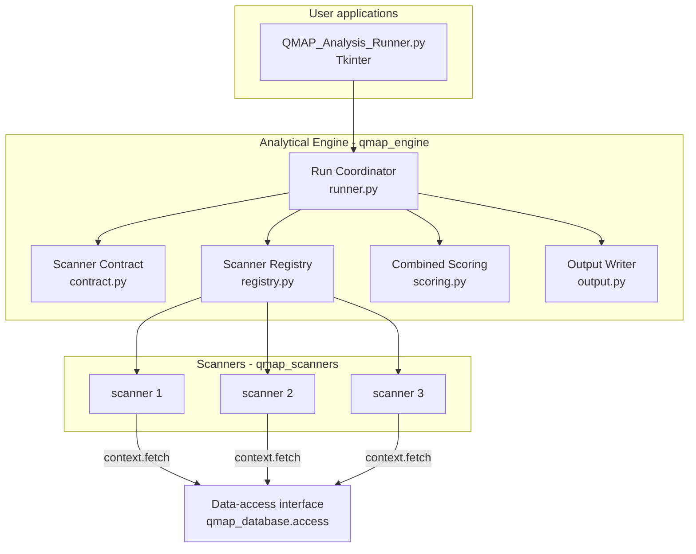
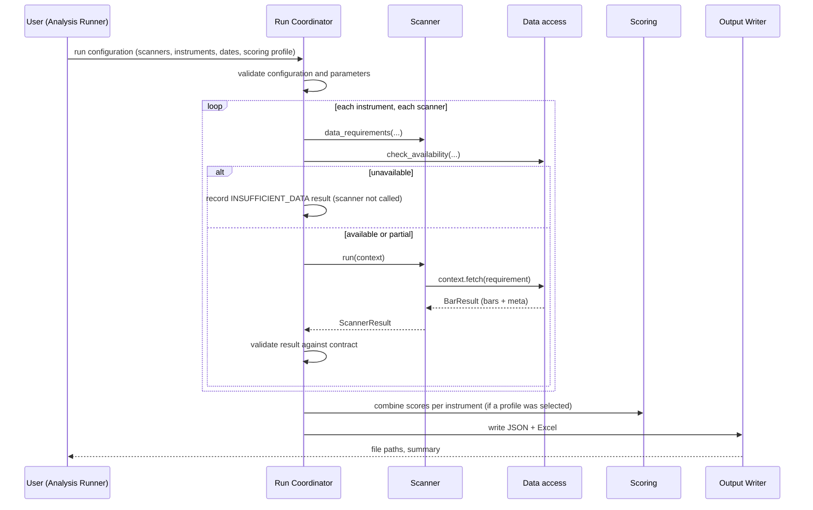

# Q-MAP — Analytical Engine and Scanner Architecture
## including the Scanner Interface Specification

**Package document 04 | Version 1.3 | 11-Nov-26 | Status: Proposed design — updated for the Owner's EMA approval of 11-Nov-26; pending final ChatGPT review and Project Owner approval**

| Field | Value |
|---|---|
| Covers | Analytical Engine structure, module responsibilities, run flow, scanner interface (inputs, outputs, rules), scanner specification template, candidate scanners (not approved), independence and change management |
| Depends on | Document 03 v1.1 (data-access interface); document 05 v1.0 (scoring and output) |
| Prepared by | Claude 2 |

> This package is a design and preparation deliverable. It is not approval to begin production coding.

**Change log**

| Version | Changed sections | Reason (review item) |
|---|---|---|
| 1.0 | — | First issue |
| 1.1 | §4 M-07 | Detailed Tkinter layout, threading, queue and shutdown conventions now marked as **proposals**, drawn from the Project Owner's standing preferences for desktop tools. Their application to Q-MAP needs confirmation. The initial interface is kept minimal (B2). |
| 1.1 | §7.3 SC-05, SC-06 | Scanners must also respect `UNRECOGNISED_SESSION_IN_RANGE`, `HELD_REVISION_EXISTS` and the `VOLUME_EXCLUDES_AUCTION` flag (A3, A2, A4) |
| 1.1 | §9 | EMA Analysis wording: candidate only, not approved (C, OD-01) |
| 1.2 | §4 M-07 | GUI conventions aligned with the **confirmed** I-02 (document 11 §1.2). The more detailed conventions are recorded as optional, not required. |
| 1.2 | §7.2 `fetch` | States exactly how a requirement becomes a `get_bars` call, including `latest_n` (document 03 v1.2 §A5) |
| 1.2 | §7.3 SC-07, SC-08 | SC-07: `affects_continuity` alone decides blocking (document 02 v1.2 §5.2). SC-08: a score is a description, not a probability or a forecast. |
| 1.2 | §9 | OD-01 shown as confirmed (EMA Analysis on daily stocks is the first-scanner candidate); its parameters remain unapproved (document 10) |
| 1.3 | §9 status note | EMA methodology D-EMA-01 to D-EMA-10 **approved** by the Owner (subject to G-03); stale-data rule D-EMA-11 still a proposal; combined-score weight deferred |

All other sections are unchanged.

---

## 1. Plain-English overview

The Analytical Engine is a **separate program component** that turns market data into analytical results.

1. **It asks the database for data** through the data-access interface. It never opens Parquet files and never runs maintenance.
2. **It runs one or more scanners.** Each scanner is an independent Python module that does its own calculations and returns a result in one standard shape.
3. **It optionally combines scanner scores** into a transparent weighted score (document 05).
4. **It writes results** as a machine-readable JSON file and a readable Excel report.

All calculations are done by Python. AI is not involved in any calculation. An AI assistant may later be shown the output to explain it, but it can never change the data, the calculations or the weights (Approved — blueprint).

**Not built (Approved — scope):**
- a plug-in framework,
- event-driven or distributed processing,
- background services,
- adaptive or AI-based logic.

---

## 2. Separation of responsibilities

| Area | Responsible for | Must never |
|---|---|---|
| **Q-MAP Database** (document 02, 03) | Import, storage, catalogue, validation, maintenance, data retrieval, aggregation | Calculate indicators or scores; interpret markets |
| **Engine core** (run coordinator, contract, registry) | Reading the run configuration; calling scanners in order; collecting results; enforcing the scanner contract | Contain scanner-specific formulas; touch storage files |
| **Scanners** | Declaring data needs; performing their own calculations; producing a standard result with facts, calculations and score | Read files directly; write files; call other scanners; change shared settings |
| **Combined scoring** (document 05) | Weighted combination of valid scanner scores; missing-result policy | Recalculate or alter scanner scores; adapt weights |
| **Output and reporting** | Writing JSON and Excel; naming files; keeping facts, scores and interpretation separate | Change any number |
| **Optional AI interpretation** (future, P2/P3) | Commentary held in a separate section or file | Modify data, results, scores or weights |
| **User applications** (Tkinter) | Letting the user choose inputs, run, see progress, open results | Contain calculation logic |

---

## 3. Component structure



**Run flow for one analysis:**



---

## 4. Module specifications

Each module is described by the nine points the assignment requires.

### M-01 Run Coordinator — `qmap_engine/runner.py` (F-31, P1, Moderate)

| Point | Specification |
|---|---|
| Purpose | Carry out one analysis run from configuration to output |
| Responsibilities | Validate the run configuration; open the data-access interface read-only; for each instrument and scanner, check availability, call the scanner, validate its result; call scoring; call the output writer; report progress |
| Inputs | `RunConfig` (section 6); data root |
| Outputs | `RunResult` (all scanner results, combined results, run context); progress messages for the GUI |
| Dependencies | Contract, Registry, Scoring, Output Writer, `qmap_database.access` |
| Communication | Plain Python function calls. Progress is sent through a thread-safe queue that the GUI polls. |
| Error handling | Configuration errors stop the run before any scanner starts, with a clear message. A scanner's unexpected exception becomes that scanner's result with status `ERROR`; the run continues for other scanners and instruments. A database-unavailable error stops the run with the database's message. |
| Testing | Unit tests with the test-fixture scanner; one end-to-end test on real data (document 06) |
| Independent change | Changes here never require scanner changes, as long as the contract is unchanged |

### M-02 Scanner Contract — `qmap_engine/contract.py` (F-30, P1, Low)

| Point | Specification |
|---|---|
| Purpose | Single definition of what a scanner receives and returns |
| Responsibilities | Data classes `ScannerInfo`, `ScannerContext`, `ScannerResult`; status codes; `validate_result()`, which checks every result before it is accepted (section 7.7) |
| Inputs / outputs | Definitions only; `validate_result(result) → list of problems` |
| Dependencies | Imports `DataRequirement` from `qmap_database.access`; nothing else |
| Communication | Imported by the runner and by every scanner |
| Error handling | A result that fails validation is replaced by status `ERROR` with the validation messages. It is never silently accepted. |
| Testing | Valid and invalid example results |
| Independent change | Contract version `1.0`. Any change is a reviewed version change, because every scanner depends on it. |

### M-03 Scanner Registry — `qmap_engine/registry.py` (F-32, P1, Low; TC-18)

| Point | Specification |
|---|---|
| Purpose | Tell the engine which scanners exist |
| Responsibilities | One explicit dictionary: `SCANNERS = {"<scanner_id>": <module>, ...}`. No automatic discovery, no plug-in loading. |
| Inputs / outputs | — / list of available scanners with their `ScannerInfo` |
| Dependencies | The scanner modules |
| Error handling | Duplicate IDs, or an `INFO.scanner_id` that differs from its key, stop start-up with a clear message |
| Testing | A test that every registered scanner exposes the required members |
| Independent change | Adding a scanner adds **one line**. No existing scanner is edited. |

### M-04 Scanner modules — `qmap_scanners/<scanner_id>/` (F-33, P1, complexity per scanner)

| Point | Specification |
|---|---|
| Purpose | One analytical method each (scanner selection is OD-01) |
| Responsibilities | Implement the interface in section 7 and the scanner's approved specification |
| Inputs | `ScannerContext`: instrument, parameters, analysis window, data fetcher |
| Outputs | `ScannerResult` (section 7.5) |
| Dependencies | `qmap_engine.contract`; pandas and numpy for calculations. Nothing from other scanners. |
| Data requirements | Declared through `data_requirements()`, and only through it |
| Error handling | Expected data problems become status `INSUFFICIENT_DATA` or `INVALID_DATA` with a message. Unexpected exceptions are caught by the runner. |
| Testing | Hand-verified calculation examples from its specification, plus contract tests |
| Independent change | Folder-contained; versioned (rule SC-10) |

### M-05 Combined Scoring — `qmap_engine/scoring.py` (F-34, P1, Moderate)

Specified in document 05. It is separate from every scanner, and it reads only the scanner results.

### M-06 Output Writer — `qmap_engine/output.py` (F-35, F-36, P1, Low)

| Point | Specification |
|---|---|
| Purpose | Turn a `RunResult` into files |
| Responsibilities | Write the run JSON (document 05, section 6) and the Excel report; apply the file-naming rule (dd_mmm_yy_hhmmss suffix); never alter values |
| Inputs / outputs | `RunResult`, output folder (Save-As folder picker) / file paths |
| Dependencies | `json` (standard library), openpyxl |
| Error handling | Write to a temporary name, then rename. If the folder is not writable: a clear message and no partial files. |
| Testing | Write → read back → compare values exactly; schema check of the JSON |
| Independent change | Report layout can change without engine or scanner changes |

### M-07 Analysis Runner — `apps/QMAP_Analysis_Runner.py` (F-37, P1, Moderate; TC-12)

| Point | Specification |
|---|---|
| Purpose | Beginner-friendly way to run an analysis on Windows without the command line |
| Responsibilities | **Initial version (P1, minimal):** one simple window with folder pickers for the data root and output folder, a list to choose instruments and scanners, date fields, a Run button, a progress indicator and a scrolling log. Nothing more until the first workflow is proven (blueprint: keep the interface simple; choose the UI after the workflow is clear). |
| Confirmed conventions (I-02, document 11 §1.2) | File picker for input files; folder picker for input folders; Save As for output files; clear progress messages; clear error messages; a simple, consistent interface. **These are the requirements.** |
| Optional conventions (not required) | The owner's wider desktop-tool preferences (numbered sections, a scrollable outer frame, ETA counters, a specific `_on_closing` shutdown sequence) were **not** part of the I-02 confirmation. Claude 1 may use them only where they make the confirmed conventions easier to meet; they must not be treated as acceptance criteria. |
| Inputs / outputs | User choices / a `RunConfig` passed to the coordinator; progress display; links to output files |
| Dependencies | `tkinter` (standard library), `qmap_engine` |
| Communication | Calls the run coordinator. **Proposed:** run long analyses in a background thread and update the screen only from the main thread through a queue. This is the standard safe pattern for Tkinter, which is not thread-safe, so the window does not freeze. This is a technical necessity for the confirmed "clear progress messages" (I-02); its exact form is Claude 1's choice, provided closing the window during a run causes no error (E2E-03). |
| Error handling | Shows the coordinator's plain-English messages; never a raw traceback (the traceback goes to the run log) |
| Testing | Manual test checklist (document 06, E2E-03); no calculation logic to unit-test |
| Independent change | UI changes never affect calculations |

The **Q-MAP Data Manager** (`apps/QMAP_Data_Manager.py`) is the equivalent window for the database component (document 02). It is listed here only to show that the two applications are separate.

---

## 5. Folder layout of the engine

```
qmap_engine\
    __init__.py
    contract.py        ScannerInfo, ScannerContext, ScannerResult, status codes, validate_result
    registry.py        SCANNERS = {...}
    runner.py          RunConfig, RunResult, run_analysis()
    scoring.py         profiles, validation, combined score (document 05)
    output.py          JSON and Excel writers
qmap_scanners\
    <scanner_id>\
        __init__.py
        scanner.py     INFO, default_parameters, validate_parameters, data_requirements, run
```

---

## 6. Run configuration (input to a run)

```json
{
  "run_config_version": "1.0",
  "data_root": "D:/QMAP_DATA",
  "output_folder": "D:/QMAP_OUTPUT",
  "instruments": ["CONCOR", "INFY"],
  "analysis_start": "2016-01-01",
  "analysis_end": "2026-11-06",
  "scanners": [
    {"scanner_id": "<approved scanner>", "parameters": {}}
  ],
  "scoring_profile_id": null,
  "options": {"include_auction_records": true, "exclude_flagged": false}
}
```

**Validation before the run starts:**
- every instrument exists,
- every scanner is registered,
- every parameter passes the scanner's `validate_parameters`,
- dates are valid,
- the scoring profile, if one is named, is valid (document 05).

Missing parameters are filled from `default_parameters()`. The **complete** parameter set, defaults included, is recorded in the output (rule SC-12).

---

## 7. Scanner Interface Specification (contract version 1.0)

### 7.1 What every scanner module must provide

```python
# qmap_scanners/<scanner_id>/scanner.py   — names are fixed by the contract

INFO = ScannerInfo(
    scanner_id="example_id",           # stable, lower_snake_case, never reused
    name="Readable name",
    version="1.0.0",                   # see SC-10
    spec_reference="docs/scanners/example_id_spec_v1.0.md",
    timeframes=("1D",),                # timeframes the scanner supports
    produces_score=True,               # False for fact-only scanners
    score_meaning="What 0, 50 and 100 mean for this scanner (document 05, section 3)",
)

def default_parameters() -> dict: ...
def validate_parameters(params: dict) -> list[str]: ...        # empty list = valid
def data_requirements(instrument_id: str, params: dict,
                      analysis_start, analysis_end) -> list[DataRequirement]: ...
def run(context: ScannerContext) -> ScannerResult: ...
```

### 7.2 What the scanner receives — `ScannerContext`

| Field | Meaning |
|---|---|
| `run_id` | Identifier of the run |
| `instrument_id` | The one instrument being analysed (one call per instrument) |
| `parameters` | The full validated parameter set |
| `analysis_start`, `analysis_end` | Window to analyse |
| `requirements` | The requirements the scanner declared, with the availability reports already obtained by the runner |
| `fetch(requirement) → BarResult` | The **only** way to obtain data. It calls `QMapData.get_bars()` with the arguments taken from the requirement as listed in document 03 v1.2 §A5 (including `latest_n`), plus the run's `include_auction_records` option, and records the request and its `meta` (data version, warnings, issues) in the result's `data_references` automatically. A requirement that was not declared through `data_requirements()` is refused with `ERROR` (SC-02). The scanner never sees a path, a file or SQL. |

### 7.3 Rules every scanner must follow

| Rule | Requirement |
|---|---|
| SC-01 | **Deterministic.** The same parameters plus the same data (`data_version`) must give an identical result. No randomness unless a seed is a parameter and is recorded. No dependence on the clock or the computer. |
| SC-02 | Obtain data only through `context.fetch`, and only for declared requirements |
| SC-03 | Never write files, never change the database, never change shared settings |
| SC-04 | Never import or call another scanner. Shared maths needed by two scanners is duplicated, or moved into a small helper module only after review. |
| SC-05 | Check the data received (`status`, `warnings`, `notes`, `is_complete`, `continuity_issues`). The scanner specification must state how it treats `UNRECOGNISED_SESSION_IN_RANGE` (uncertain session boundaries), `HELD_REVISION_EXISTS` (newer, unapproved source data exists) and `FLAGGED_ROWS_INCLUDED`. Return `INSUFFICIENT_DATA` or `INVALID_DATA` instead of calculating on inadequate data. |
| SC-06 | Never treat a forming bar as complete. The specification states whether incomplete bars are used, excluded or cause rejection. A scanner that uses daily volume must account for `volume_complete = False` and the flag `VOLUME_EXCLUDES_AUCTION`, since daily volume excludes auction volume (document 03 v1.1, §B7). |
| SC-07 | Never calculate returns or continuity-dependent measures across an issue with `affects_continuity = True` (e.g. Nifty IT 28-May-04). Either restrict the window to one side, stating this in `status_messages`, or return `INVALID_DATA`. **`affects_continuity` alone decides** (v1.2): the issue's status is shown to the user but does not change blocking, because the Data Manager sets `affects_continuity = false` whenever the owner marks an issue `VERIFIED_OK` (document 02 v1.2 §5.2). |
| SC-08 | Provide a score only when status is `OK`. The score must be between 0 and 100 under the scanner's approved calibration (document 05). A score **describes** how strongly the scanner's stated condition holds on the data used. It is not a probability of profit, a forecast of direction or a trading recommendation, and the scanner's `score_meaning` must not say or imply otherwise. |
| SC-09 | Keep source references, facts, calculations, score and interpretation in their separate sections (7.6) |
| SC-10 | Version numbers: **MAJOR** when a formula, score calibration or result meaning changes; **MINOR** when outputs are added without changing existing ones; **PATCH** for fixes that do not change any correct result. Each version is recorded in every result. |
| SC-11 | Expected data problems are statuses, not exceptions. Unexpected exceptions are allowed to propagate to the runner, which records `ERROR`. Exceptions are never swallowed silently. |
| SC-12 | All parameters, including defaults, appear in the result |
| SC-13 | Keep no state between calls. Each instrument is analysed independently. |

### 7.4 Result status codes

| Status | Meaning | Score allowed |
|---|---|---|
| `OK` | Calculation completed on adequate data | Yes |
| `INSUFFICIENT_DATA` | Not enough usable data (too few bars, required field missing, range too short) | No |
| `INVALID_DATA` | Data present but unusable for this method (continuity break, flagged rows not allowed) | No |
| `NOT_APPLICABLE` | The method does not apply (e.g. timeframe not supported for this instrument) | No |
| `ERROR` | Unexpected failure, or the result failed contract validation | No |

### 7.5 Result structure — `ScannerResult`

```json
{
  "result_schema_version": "1.0",
  "scanner": {
    "scanner_id": "example_id",
    "name": "Readable name",
    "version": "1.0.0",
    "spec_reference": "docs/scanners/example_id_spec_v1.0.md"
  },
  "subject": {
    "instrument_id": "CONCOR",
    "timeframe": "1D",
    "analysis_start": "2016-01-01",
    "analysis_end": "2026-11-06"
  },
  "parameters": {"...": "complete parameter set"},
  "status": "OK",
  "status_messages": [],
  "data_references": [
    {
      "request": {"instrument_id": "CONCOR", "timeframe": "1D", "start": "2016-01-01", "end": "2026-11-06",
                  "fields": ["open", "high", "low", "close"]},
      "dataset_id": "NSE_EQ_DAILY",
      "data_version": "run_000034/import_000412",
      "returned_first_ts": "2016-01-01", "returned_last_ts": "2026-11-06", "bar_count": 2700,
      "timezone": "Asia/Kolkata", "ts_meaning": "interval_start_ist_wallclock",
      "status": "OK", "warnings": [], "issues": []
    }
  ],
  "facts": {"...": "objective values read or directly computed from the data"},
  "calculations": {"...": "scanner-specific intermediate measures"},
  "detail_tables": {"...": "optional: name -> list of rows, for verification"},
  "score": {
    "value": 76.25,
    "scale": "0-100",
    "calibration": "reference to the calibration rule in the scanner spec",
    "components": [{"name": "...", "value": 0.0, "weight_in_scanner": 1.0}]
  },
  "interpretation": null
}
```

For scanners that produce no score, `score` is `null`.

### 7.6 Keeping the five kinds of information separate

| Section | Contains | Example | May AI change it? |
|---|---|---|---|
| `data_references` | Exactly which data was used, including version, warnings and issues | NSE_EQ_DAILY, CONCOR, run_000034, 2,700 bars | No |
| `facts` | Objective values anyone can check against the data | Last close 439.80 on 06-Nov-26; 5-day simple average of close 428.55 | No |
| `calculations` | Scanner-specific measures defined in its spec | Distance of close from average: +2.6251% | No |
| `score` | The scanner's 0–100 score and its calibration reference | 76.25 | No |
| `interpretation` | Optional commentary; always `null` when produced by Python | "Price is moderately above its short average…" — only in a separate, labelled layer (document 05, section 7) | Only this section, and only in its separate layer |

### 7.7 Contract validation of every result (`validate_result`)

| Check | Failing result becomes |
|---|---|
| All required keys present; `result_schema_version` known | `ERROR` |
| `scanner_id` and `version` match the registered `INFO` | `ERROR` |
| `status` is one of the five codes | `ERROR` |
| `score` present only if status `OK` and `produces_score`; value is a finite number in [0, 100] | `ERROR` |
| `data_references` non-empty when status is `OK` | `ERROR` |
| `interpretation` is `null` | `ERROR` (Python never writes interpretation) |
| JSON-serialisable (no NaN or infinity, no Python-only objects) | `ERROR` |

### 7.8 Test-fixture scanner (tests only, not a product scanner)

A tiny scanner, `fixture_close_vs_sma`, lives under `tests/fixtures`. It is not registered in the product registry. It exists only to test the contract, the runner, scoring and output without waiting for real scanner approval.

**Method.**
- *Fact:* last close.
- *Fact:* simple average of the last N closes.
- *Calculation:* distance = (close ÷ average − 1) × 100.
- *Test-only score:* clip(50 + 10 × distance, 0, 100).

**Hand-checked example** (CONCOR, N = 5, data to 06-Nov-26):
- Closes: 417.85, 419.15, 425.10, 440.85, 439.80.
- Average: 2,142.75 ÷ 5 = **428.55**.
- Distance: 11.25 ÷ 428.55 = **2.6251%**.
- Score: 50 + 26.251 = **76.25**.

This scoring rule is purely a test device. It does not suggest how real scanners should score.

---

## 8. Scanner specification template (required before any scanner is coded)

No scanner is implemented until its specification has been approved. That is OD-01 for the selection, and OD-09 for each calibration. Every specification must contain:

1. **Purpose.** The question the scanner answers, in plain English.
2. **Data requirements.** Dataset kind, timeframe(s), fields (required or optional), look-back, minimum bars, policy on incomplete and flagged bars, continuity handling.
3. **Parameters.** Name, meaning, default, allowed range.
4. **Calculations.** Exact formulas, including the first-value or warm-up rules of moving averages, how ties and equal prices are handled, and rounding.
5. **Facts and calculations produced.** Names, units, definitions.
6. **Score calibration.** Raw measure(s) → 0–100. What 0, 50 and 100 mean. Direction. Clipping. The reason it is comparable with other scanners (document 05, section 3).
7. **Status rules.** Exactly when the result is `INSUFFICIENT_DATA`, `INVALID_DATA` or `NOT_APPLICABLE`.
8. **Hand-verified examples.** At least three, on real data, including one edge case. Values must be independently computable, for example in Excel.
9. **Tests.** The list of unit and reference tests.
10. **Known limitations.**

---

## 9. Candidate scanners (OD-01)

**Status (v1.2).** OD-01 is confirmed: EMA Analysis on daily stocks is the first-scanner candidate, subject to data suitability. *(v1.3)* The Owner has **approved the EMA methodology** in document 10 (D-EMA-01 to D-EMA-10), subject to the G-03 continuity rule; the scanner's weight in any combined profile is deferred to the profile decision (G-10). The stale-data rule D-EMA-11 remains a proposal (document 12). MA Affinity and Breakout Analysis remain unselected candidates (G-11).

The blueprints name these as discussed examples only. The assessment below is input for the Project Owner's selection. **No formula is defined here.**

| Candidate | Likely data | Data suitability (Deliverable 1) | Indicative complexity | Points to settle in its specification |
|---|---|---|---|---|
| Moving Average Affinity | Daily stocks; possibly intraday indices | Excellent for daily stocks: 28 years of history, complete OHLCV. Unverified anomalies (CONCOR 2013) must be respected (SC-07). | **High**. It searches many MA types and periods, and needs a precise definition of "affinity" and its validation method. | Definition of interaction; period range; in-sample and out-of-sample treatment; score meaning. The owner has prior work on this concept. For this fresh project it must be re-specified and approved; it must not be copied from earlier code (revised instruction, section 1). |
| EMA Analysis | Daily stocks or intraday indices | Good on both | **Low to Moderate** | Which EMAs; what is measured (position, slope, crossovers); score meaning |
| Breakout Analysis | Intraday indices (Nifty, Bank Nifty) or daily stocks | Intraday: good from 2025 in the sample; CAS changes the closing structure from 03-Aug-26 | **Moderate** | Breakout definition (range, period); confirmation rule; whether auction prints count as breakout prices |

**Recommendation for sequencing (Proposed).**
- Make the **first** scanner the one whose specification can be approved and hand-verified fastest, using daily stock data. Daily stock data has the longest, simplest history and no session complexity.
- A lower-complexity first scanner, such as EMA Analysis (**a candidate only, not an approved scanner**), proves the full chain from database to scanner to output early, which is the blueprint's priority.
- A high-complexity scanner, such as MA Affinity, is then added on a proven foundation.
- The final choice belongs to the Project Owner.

---

## 10. Independence and change management

| Change | What is touched | What is not touched |
|---|---|---|
| Add a scanner | New folder `qmap_scanners/<id>/`; one line in `registry.py`; its spec and tests | Every other scanner; contract; database |
| Change a scanner's formula | That scanner's folder; its version (MAJOR); its tests and examples | Other scanners. Scoring profiles that use the scanner must be re-confirmed (document 05, section 4.4). |
| Change data storage | Database internals | Engine and scanners (the interface is unchanged) |
| Change the report layout | `output.py` | All calculations |

The regression test suite runs every scanner's reference tests after any change (document 06). This proves that a change in one place did not alter the established outputs of another.

---

## 11. Error-handling summary

| Situation | Behaviour |
|---|---|
| Invalid run configuration | Run does not start; message names the problem and the fix |
| Database locked or missing | Run does not start; database message shown |
| Data unavailable for one instrument and scanner | That result is `INSUFFICIENT_DATA` with the availability reasons; the run continues |
| Scanner raises an unexpected exception | That result is `ERROR`; the traceback goes to the run log; the run continues |
| Result fails contract validation | `ERROR` with validation messages |
| Scoring cannot be produced (missing result, invalid weights) | Combined result status per document 05; never a silent zero |
| Output folder not writable | Clear message; no partial files |

*End of document 04, v1.3.*
