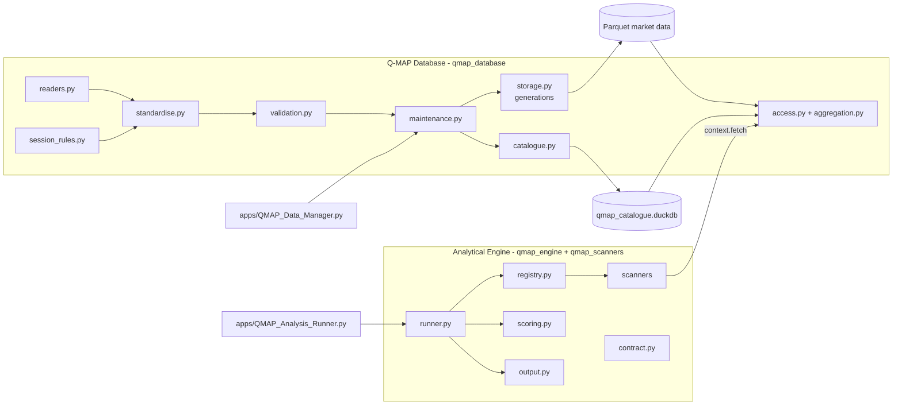

# Q-MAP — Claude 1 Implementation Handover

**Package document 08 | Version 1.7 | 12-Nov-26 | Status: Proposed — v1.7 records that all EMA reference values are source-verified; pending ChatGPT final review and Project Owner Gate 0 decision. Not approval to code.**

> **This package is a design and preparation deliverable. It is not approval to begin production coding.**
>
> Claude 1 must not start any milestone until the Project Owner has approved this package (as corrected by the ChatGPT review), **and** the approval gates listed for that milestone in section 7 are met.

---

**Change log**

| Version | Changed sections | Reason (review item) |
|---|---|---|
| 1.0 | — | First issue |
| 1.1 | §1 | Reading list points to the revised documents |
| 1.1 | §3, §4, §5 | Generation-based storage, `staging` and `held` areas, `instrument_rule` table (A1, A2, A6) |
| 1.1 | §6 | Python version no longer frozen at 3.12 (B1); GUI conventions marked as proposals (B2) |
| 1.1 | §7 | Gate 0 adds I-01 and I-02; M1 scope and acceptance add holding revisions, generation commit, failure injection, restore test, session confirmation and tick rules; M2 adds ACC-10 (A1–A6, B3–B5) |
| 1.1 | §9, §10 | Must-not list adds automatic revision application and unverified off-tick quarantine; limitations updated |
| 1.2 | §1 | Reading list and authority order include the confirmed Owner Decision Record (11 §1.1) and the Owner Decision Register (document 12) |
| 1.2 | §2 | R-06 and R-10 reflect confirmed OD-04 and OD-03; R-16 and R-17 added for the confirmed decisions and GUI conventions |
| 1.2 | §6 | Python 3.12.10 (I-01); exact version pins and tests only on the pins (G-15); GUI conventions per the confirmed I-02 |
| 1.2 | §7 | Gate 0 updated; M1 shown as M1a/M1b/M1c (scope unchanged) with the recommended build order M1a → M2 → M1b (Owner decision OD-10); Gate 5 reflects confirmed OD-02/OD-03; delivery-plan status stated |
| 1.2 | §9, §10 | Must-not list and limitations extended for the v1.2 clarifications |
| 1.3 | §1, §2 | References to current versions; R-18 records the Owner decisions of 11-Nov-26 (G-03, G-04, G-16, EMA methodology, pilot method; G-01 not authorised) |
| 1.3 | §7 | Gate 0 and milestone start conditions updated; **baseline build order restored to M1a → M1b → M2** (OD-10 remains an open proposal, not a requirement); Gate 3 reflects the approved EMA methodology; M1 acceptance lists the new tests |
| 1.3 | §9, §10 | Must-not list and limitations updated for G-02, G-03, G-09, G-16 and TC-26 |
| 1.4 | §7 Gate 0, M1, new M1c subsection; §10 V-04 | **Targeted correction:** V-04 (full stock-universe inventory) removed from Gate 0; Gate 0 and M1a/M1b/M2 proceed on the inspected sample files; V-04 is a mandatory prerequisite of M1c only and cannot be performed until G-01 is authorised; M1c prerequisites listed explicitly. No other change. |
| 1.5 | §7 (new quick reference; M1 order sentence; Gate 3) | Sequence stated as approved (M1a → M1b → M2 → M1c → M3); one-page quick reference for Claude 1 added; Gate 3 adds D-EMA-12, OD-12 and source verification (document 13). No other change. |
| 1.6 | §7 Gate 3, quick reference, §10 G-03 row | CONCOR reference values source-verified; INFY verification still required before M3; three newly identified CONCOR G-03 cases noted |
| 1.7 | §7 Gate 3, quick reference, §10 G-03 row | INFY reference values source-verified (document 13 v1.2), so source verification is no longer a Gate 3 condition; INFY's seven newly identified G-03 cases noted |

## 1. How to use this handover

| Order | Read | Why |
|---|---|---|
| 1 | Human-Readable Blueprint v1.0 | Governs scope and intent; highest authority |
| 2 | Technical Blueprint v1.0 | Technical direction |
| 3 | Q-MAP_01 Data Inventory and Quality Report v1.2 | What the actual data looks like |
| 4 | Q-MAP_07 Register v1.1, sections A–D2 | What is decided, what is not, what is unverified, what information is needed |
| 5 | This document | What to build, in which order, and how to prove it |
| 6 | Q-MAP_11 v1.7 (Readiness Checklist) and Q-MAP_12 v1.5 (Owner Decision Register) | What is confirmed, what is still open, and what each milestone needs before it starts |
| 7 | Q-MAP_02 v1.6, 03 v1.2, 04 v1.3, 05 v1.1, 06 v1.5, 07 v1.6 | Detailed specifications, read per milestone |
| 8 | Q-MAP_09 v1.6, 10 v1.7 and 13 v1.2 | Stock-universe and pilot procedure (M1c); EMA scanner specification — methodology approved (M3); EMA verification evidence and the remaining source check (M3) |

**Authority when documents disagree:**
1. Human-Readable Blueprint.
2. Technical Blueprint.
3. Approved decisions: D-01 to D-13; OD-01 to OD-09 as confirmed in document 11 §1.1; and any decision in document 12 once the Owner records it.
4. This design package.

Report any conflict to the Project Owner. Do not resolve it silently.

**Project roles (unchanged):**
- Claude 2 designed.
- ChatGPT reviews and consolidates corrections.
- The Project Owner approves.
- Claude 1 implements in the fresh Q-MAP GitHub repository.

Claude 1 must not use, copy or rely on `old-Q-MAP-ignore` or any earlier repository.

---

## 2. Approved requirements to implement

| # | Requirement | Source |
|---|---|---|
| R-01 | Two independent components: Q-MAP Database and Q-MAP Analytical Engine | Blueprints |
| R-02 | Local, offline, single-user Windows operation | Blueprints |
| R-03 | Parquet for market data; DuckDB for querying; no SQLite without a demonstrated need | Blueprints; revised instruction |
| R-04 | Simple catalogue: datasets, instruments, fields, timeframes, ranges, latest records, update status, quality/completeness status | Blueprints; revised instruction §4 |
| R-05 | Validation that reports issues; no silent failures; no fabricated fields | Blueprints |
| R-06 | Incremental maintenance; no rebuild on scanner runs; initial preparation separate from maintenance; never assume append-only; historical revisions held for owner review (OD-04, **confirmed**) | Blueprints; revised instruction §4; review A2 |
| R-07 | One stable data-access interface; the engine never touches storage | Blueprints |
| R-08 | Aggregation per the OHLCV rules, respecting IST, sessions, holidays, missing and incomplete intervals; 1-minute data preserved; not every timeframe precomputed | Blueprints |
| R-09 | Two or three independent scanner modules (selection pending); no plug-in framework | Blueprints |
| R-10 | Transparent deterministic weighted combined score meaning **Combined Technical Setup Strength** (OD-02); common scale; weights total 100%; contributions visible; missing ≠ zero; **reject** the combined score when a required result is missing or invalid (OD-03). Not a probability, forecast or recommendation. | Blueprints; OD-02, OD-03 |
| R-11 | Engine works without AI; structured output separating facts, results, score and interpretation | Blueprints |
| R-12 | Beginner-friendly Windows workflow; GUI folder and file pickers; no CLI-only user tasks | Blueprints |
| R-13 | Backup and restore method defined before routine maintenance | Technical Blueprint |
| R-14 | Decisions D-01 to D-13 (summarised in 07 §C), including D-09 in its strengthened form (`source_ts` retained in the stored record) | Deliverable 1 v1.1; revised instruction §2.2 |
| R-15 | Every milestone runnable and testable on actual data; results checked against hand-verified examples | Blueprints |
| R-16 | Confirmed Owner decisions OD-01 to OD-09 (11 §1.1), including OD-05 (no automatic off-tick quarantine without a verified tick rule), OD-06 (pilot only after the universe inventory), OD-07 (disclose coverage; unavailable when history is insufficient), OD-08 (net volume deferred) and OD-09 (fixed, deterministic scoring; parameters need approval) | Document 11 §1.1 |
| R-17 | GUI: file picker, folder picker, Save As, clear progress and error messages, simple consistent interface (I-02); Python 3.12.10 (I-01) | Document 11 §1.2 |
| R-18 | Owner decisions of 11-Nov-26 (record: 11 v1.3 §1.3): **G-03** every ±15% move (open or close) blocks continuity-dependent calculations until the Owner verifies that occurrence and marks it `VERIFIED_OK`; **G-04** a tick rule is verified only with recorded evidence, effective-from (and effective-to where known) and confirmation, otherwise off-tick rows are flagged only; **G-16** only exact SHA-256 matches are duplicates, any difference goes to the Owner, no automatic merging or selection; **D-EMA-01 to 10** EMA methodology approved (subject to G-03; combined weight deferred); **pilot method** approved (CONCOR and INFY included); **G-01** inventory script not authorised | Document 11 §1.3 |

---

## 3. Proposed architecture (pending review and approval)



| Specification | Document |
|---|---|
| Storage, catalogue, import, validation, maintenance, backup | 02 |
| Data-access interface and aggregation | 03 |
| Engine modules and scanner interface | 04 |
| Combined scoring and run output | 05 |
| Tests and acceptance | 06 |

---

## 4. Initial repository structure

Create folders **only when the milestone that needs them begins**. Do not create placeholders to make the repository look complete (Approved — blueprint).

```
Q-MAP\
├── docs\                          approved blueprints and this design package (as approved)
│   └── scanners\                  one approved specification per scanner (from M3)
├── qmap_database\                 M1–M2
│   ├── __init__.py
│   ├── errors.py                  exception classes (document 03 §A6)
│   ├── settings.py                read/write the local settings file (data root path)
│   ├── catalogue.py               create and query the 11 catalogue tables (document 02 v1.1 §5)
│   ├── readers.py                 readers R1–R4 (document 02 §6.1)
│   ├── session_rules.py           day-pattern detection, calendar derivation
│   ├── standardise.py             record types, auction timestamp, source_ts
│   ├── validation.py              checks V-* and quarantine
│   ├── storage.py                 generation staging, validation, activation, recovery, integrity check
│   ├── maintenance.py             initial load, incremental update, held revisions and approval, backups, restore check
│   ├── aggregation.py             interval rules (document 03 Part B)        (M2)
│   └── access.py                  QMapData public interface                 (M2)
├── qmap_engine\                   M3–M6
│   ├── __init__.py
│   ├── contract.py
│   ├── registry.py
│   ├── runner.py
│   ├── scoring.py                                                           (M5)
│   └── output.py
├── qmap_scanners\                 one folder per approved scanner            (M3–M4)
├── apps\
│   ├── QMAP_Data_Manager.py       Tkinter, single file                       (M1)
│   └── QMAP_Analysis_Runner.py    Tkinter, single file                       (M6; minimal version from M3)
├── config\
│   └── scoring_profiles.json                                                (M5)
├── tests\
│   ├── run_all_tests.py           run from IDLE (F5)
│   ├── fixtures\
│   ├── golden\
│   └── test_*.py
└── requirements.txt               exact pins (==) for Python 3.12.10, fixed at Gate 0
```

The user's **data root** (e.g. `D:\QMAP_DATA`) and the source market files are never placed in the repository.

---

## 5. Module responsibilities (summary)

| Module | Responsibility | Must not | Milestone |
|---|---|---|---|
| `readers.py` | Parse the four source formats into raw frames | Decide validity, write files | M1 |
| `session_rules.py` | Classify days (REGULAR / CAS / SPECIAL / SPECIAL_CAS); derive calendar | Change prices | M1 |
| `standardise.py` | IST conversion, duplicates, record types, auction `ts` plus `source_ts` | Adjust prices | M1 |
| `validation.py` | Apply V-* checks; route rows to stored, flagged or quarantine; create issues | Repair data | M1 |
| `storage.py` | Generation commit protocol (stage → validate → rename → single catalogue transaction), start-up recovery, retention, integrity check (02 v1.2 §9.4) | Modify files of an active generation; know about scanners | M1 |
| `maintenance.py` | Initial load and incremental update, change detection, **holding** of every historical revision with evidence, owner approve or reject, re-validation after confirmations, backups, restore check | Apply a historical revision without owner approval; run on scanner request | M1 |
| `catalogue.py` | All catalogue SQL | Hold market data | M1 |
| `aggregation.py` | Document 03 Part B rules | Fill missing data | M2 |
| `access.py` | The only public read interface | Write anything | M2 |
| `contract.py`, `registry.py`, `runner.py` | Document 04 | Contain scanner formulas | M3 |
| `qmap_scanners/<id>` | One approved method each | Touch files; call other scanners | M3–M4 |
| `scoring.py` | Document 05 §2–6 | Alter scanner scores | M5 |
| `output.py` | JSON and Excel | Change values | M3 (JSON), M6 (full report) |
| `apps/*` | User interaction only | Contain calculations | M1, M6 |

---

## 6. Technology and dependencies

| Item | Choice |
|---|---|
| Python | **Python 3.12.10** on the owner's Windows PC (I-01, confirmed), run from IDLE or Thonny. Recorded in the M1 evidence. |
| Third-party packages | `duckdb`, `pandas`, `pyarrow`, `openpyxl` — **no others without Project Owner approval** |
| Versions | **Exact** pins (`==`) in `requirements.txt` at Gate 0, chosen for Python 3.12.10 and recorded in the M1 evidence. Code is written and tested **only** against those pins; a test run on any other version is not milestone evidence (T-ENV-01). Reasons (G-15): DuckDB's Python API has changed between versions (the exploratory work met a removed `fetchone()` on relation objects in DuckDB 2.0.0), and a newer DuckDB may upgrade the catalogue file so that an older version can no longer open it. A version upgrade is therefore a deliberate change: back up the catalogue, change the pin, re-run the full test suite, record the result. Nothing in the exploratory scripts' tested environment (Linux, Python 3.12.3) is evidence for the owner's PC. |
| Standard library | `tkinter`, `unittest`, `json`, `hashlib`, `os`, `shutil`, `datetime`, `dataclasses`, `queue`, `threading`, `logging` |
| Installation | The only command-line step: a one-time `pip install -r requirements.txt`, given with copy-paste instructions for the Windows Command Prompt. Everything else runs from IDLE. |

**Coding standards** (Approved — assignment and blueprints):
- Purpose-revealing names.
- One task per function.
- Comments explain **why**.
- File order: Imports → Constants → Helpers → Main logic → Execution.
- Explicit error handling; no silent failures.
- Small changes; no broad rewrites.
- No unrequested helper files or documentation.

**User interface — confirmed conventions (I-02) and initial approach.** Required: file picker for input files; folder picker for input folders; Save As for output files; clear progress messages; clear error messages; a simple, consistent interface. Initial approach:
- One self-contained plain-Tkinter file per application.
- Folder and file pickers; a clear Run button; a progress indicator; a scrolling log.
- Plain-English messages.
- Dates shown as dd-mmm-yy.
- Non-code outputs named with a `dd_mmm_yy_hhmmss` suffix.

**Optional conventions — not required (I-02 did not include them).** These come from the Project Owner's wider preferences for desktop tools. Claude 1 may use them where they help meet the confirmed conventions, but they are **not acceptance criteria**:
- numbered sections (1. Input → 2. Output → 3. Options → Progress/Status → Live Log);
- a scrollable outer frame (`self._scroll_frame`);
- a detailed live status (elapsed time, ETA, counters);
- a background worker thread with queue polling;
- a specific `_on_closing` shutdown sequence with a `_closing` guard.

Of these, running long work outside the window's main thread is a **technical necessity** for the confirmed "clear progress messages", because Tkinter is not thread-safe and the window would freeze otherwise. Its exact form is Claude 1's choice, provided that closing the window mid-run causes no error (E2E-03).

---

## 7. Implementation sequence

Each milestone ends with something **the Project Owner can run on actual data**. A design document or a green test report alone is not proof (Approved — blueprint).

### Quick reference for Claude 1 (added v1.5)

| Question | Answer |
|---|---|
| What is approved? | Blueprints v1.0; D-01 to D-13; OD-01 to OD-09; I-01 (Python 3.12.10); I-02 (GUI conventions); G-03, G-04, G-16; EMA methodology D-EMA-01 to 10; pilot method (record: 11 §1.1–§1.3). The package itself only after GATE-0. |
| What may start after Gate 0? | M1a, then M1b, then M2 — on the inspected sample files only |
| Order | M1a → M1b → M2 → M1c → M3 → M4 → M5; M6 after M3. OD-10 not adopted. |
| What must be implemented? | §2 requirements R-01 to R-18; specifications 02, 03, 04, 05; tests 06; per-milestone checklist 11 |
| Files and modules | Repository layout §4; module table §5 (`qmap_db`, `qmap_engine`, the two Tkinter apps, `tests/`) |
| Acceptance and evidence | Per milestone below and in 11 §3; tests specified in 06 (none executed yet) |
| What must not change | Approved decisions; the data-access interface contract (03, interface 1.1) without a review; the "only door" rule; anything in §9 |
| Blocked | M1c (G-01 not authorised); M3 (OD-12 or M1c, D-EMA-11, D-EMA-12); M4 (G-11); M5 (G-10) |
| Out of scope | P2/P3 items (07 §F); cloud, remote API, AI integration; the inventory script; `old-Q-MAP-ignore` |

### Gate 0 — before any code

- This package (index 00 v1.10) is approved by the Project Owner as corrected by the ChatGPT review.
- OD-04, OD-05 and OD-06 — **confirmed** (11 §1.1).
- **I-01** — confirmed: Python 3.12.10. Package versions are chosen and pinned exactly in `requirements.txt`; T-ENV-01 prints them on the owner's PC.
- **I-02** — confirmed (see §6).
- G-03, G-04 and G-16 — **decided** by the Owner on 11-Nov-26 (no longer start conditions).
- **Not a Gate 0 condition: V-04** (full stock-universe inventory). Gate 0, M1a, M1b and M2 proceed using the **already inspected sample files** (NIFTY and BANKNIFTY 1-minute samples, CONCOR, INFY, NIFTYIT). V-04 is a prerequisite of **M1c only** (see the M1c subsection below).

**Delivery-plan status.** The original plan's targets (Day 3: real historical data retrievable locally; Day 5: first scanner result; Day 7: two scanners and combined scoring) have **not** been demonstrated. Design documents do not satisfy them. Day 7 also needs a second approved scanner, which has not been selected (G-11).

### M1 — Local database foundation (actual data import and catalogue)

Document 11 splits M1 into **M1a** (foundation on the inspected files), **M1b** (maintenance, held revisions, generations, backup) and **M1c** (pilot universe load). The scope below is unchanged; the split only makes start conditions clear. **Approved implementation sequence: M1a → M1b → M2 → M1c → M3**, then M4 → M5, with M6 after M3. Gate 0 allows M1a, M1b and M2 on the inspected sample files. M1c has its own prerequisites (G-01 authorisation, completed and reviewed inventory, presented and Owner-approved pilot list). M3 follows M1c in this sequence; whether M3 may start on CONCOR and INFY while M1c is still blocked is open Owner decision **OD-12** (document 12) — until the Owner decides, M3 waits for M1c. The alternative order of proposal OD-10 is **not adopted**. M1b must be complete before routine maintenance of real data begins (Technical Blueprint: backup and restore defined before routine maintenance).

| Item | Content |
|---|---|
| Scope | Catalogue (11 tables, including `instrument_rule`); readers R1–R4; standardisation with **separate** session classification, record classification and completeness (02 v1.2 §6.2): SPECIAL only from an official calendar or owner confirmation, `UNRECOGNISED_SESSION_SHAPE` otherwise; CAS-candidate and unrecognised-day confirmation lists; validation and quarantine, with off-tick quarantine only under a verified tick rule; derived calendar (provisional) plus optional official calendar CSV; issue register; initial load; incremental update with change detection; **every historical revision held** with evidence and owner approve or reject; **generation-based instrument commit** with start-up recovery; backups and restore check; logs and Excel validation report; Data Manager GUI (minimal) |
| Data | M1a and M1b: the inspected sample files only (NIFTY and BANKNIFTY 1-minute samples, CONCOR, INFY, Nifty IT). The pilot universe is loaded only in **M1c**, under the prerequisites below. The full universe is not part of this plan. |
| Runnable outcome | The owner opens `QMAP_Data_Manager.py` in IDLE, picks the data root and source files, runs **Initial load**, sees progress and a validation report, confirms detected CAS days, then runs **Update** after adding a file |
| Acceptance | Document 06 v1.3: L1–L3 pass, including **T-SES-10** (truncated day), **T-SES-11** (weekend session), **T-FILE-06 to 09** (resolution test), **T-DQ-02c, T-DQ-07, T-DQ-08** (G-04, G-03), **T-MNT-03b** (false-positive uniform factor), **T-MNT-06a to 06c** (failure injection), **T-MNT-11, 11b, 12 to 16** (G-16 conflicts and duplicates; G-09 scope and inaccessible sources; held revision with new rows) and **T-BKP-01** (restore consistency); T-CAL-01 to 04 if a calendar file is supplied; ACC-02, 03, 04, 05, 06, 08 pass; E2E-01 performed by the Owner on actual data |
| Not in M1 | Data-access interface for scanners, aggregation, any scanner |

#### M1c — Pilot universe load (~50 stocks), after M2

Uses the M1a/M1b machinery with no new features. **M1c may not begin until all of the following hold:** (1) the Project Owner has **explicitly authorised G-01** (the exploratory universe-inventory script; currently **not authorised**); (2) the inventory (V-04) has been **completed** and its results **reviewed**; (3) the proposed pilot list (about 50 stocks, CONCOR and INFY included, chosen by the approved method) has been **presented to the Project Owner**; (4) the Project Owner has **approved that actual list**. V-04 cannot be performed before G-01 is authorised. M1a, M1b and M2 are also complete (baseline sequence M1a → M1b → M2, then M1c). Acceptance: document 11 v1.7, M1c checklist.

### M2 — Common data-access interface and aggregation (historical retrieval)

| Item | Content |
|---|---|
| Scope | `access.py` (all 10 functions, document 03 Part A) and `aggregation.py` (Part B) |
| Runnable outcome | A short example script, run from IDLE, prints for the owner: `list_instruments()`; NIFTY 5-minute bars for 17-Aug-26; BANKNIFTY 19-Aug-26 showing the incomplete 13:25 bar; CONCOR latest 5 closes; and a deliberate error showing its plain message. The script is part of the M2 evidence and is listed in the M2 file inventory. |
| Acceptance | L4–L5 pass; **ACC-01** (0 differences in O/H/L/C against the owner's derived 3m/5m/15m/daily/monthly files over 09-Jan-25 to 30-Oct-26); ACC-07; **ACC-10** (performance measured on the owner's PC); manual verification of T-AGG-01, 02, 03, 07 and 13 recorded |

### Gate 3 — before M3

OD-01 confirmed; the EMA methodology (document 10, D-EMA-01 to D-EMA-10) **approved** 11-Nov-26, subject to G-03. Still required before M3: (1) M1c complete, or Owner decision **OD-12** allowing M3 first; (2) Owner decisions **D-EMA-11** (stale data) and **D-EMA-12** (numeric precision; document 13 §3); (3) the T-EMA reference values verified against source data — **done for CONCOR and INFY** (document 13 v1.2); Claude 1 uses those values as the M3 targets, with T-EMA-18 values conditional; (4) the approved specification copied to `docs/scanners/ema_trend_alignment_spec_v1.0.md`.

### M3 — First approved scanner (plus engine core)

| Item | Content |
|---|---|
| Scope | `contract.py`, `registry.py`, `runner.py`; the first scanner; JSON output; a minimal Analysis Runner able to run that one scanner |
| Runnable outcome | The owner runs the scanner on CONCOR and INFY (or the approved data) from the Analysis Runner and opens the JSON |
| Acceptance | L6 pass; the scanner's T-SCC tests pass; three hand-verified cases recorded (document 06 §6); golden output saved |

### M4 — Additional approved scanner(s)

| Item | Content |
|---|---|
| Gate | Each scanner's specification and calibration approved |
| Runnable outcome | Each scanner runs from the Analysis Runner alongside the first |
| Acceptance | As M3 per scanner; T-SCC-REG shows earlier scanners' golden outputs unchanged |

### Gate 5 — before M5

OD-02 (meaning) and OD-03 (reject policy) are **confirmed**. Still required: at least two approved scoring scanners (M3, M4) and an Owner-approved profile composition and weights (G-10, document 12).

### M5 — Weighted combined scoring

| Item | Content |
|---|---|
| Scope | `scoring.py`; `scoring_profiles.json`; combined section in the JSON |
| Runnable outcome | A run with a profile produces combined scores, with each component's score, weight and contribution visible |
| Acceptance | L8 pass (T-SCO, T-MSR); E2E-05; the owner checks one combined score with a calculator from the JSON |

### M6 — Practical output and reporting

| Item | Content |
|---|---|
| Scope | Full Analysis Runner (owner's GUI standard); Excel run report; integrity hash |
| Runnable outcome | The owner runs a complete analysis without developer help and reviews the Excel report |
| Acceptance | E2E-03 and E2E-04 performed by the owner; T-OUT pass |

Cloud, remote access, AI integration, dashboards, decision engines and further scanners are **not** milestones in this plan (Approved — blueprint).

---

## 8. Testing requirements (summary)

- Use the `unittest` suite, runnable from IDLE (`tests/run_all_tests.py`).
- Real-data tests skip with a clear message when the files are absent.
- Each change runs the tests for its layer plus the L4 interface tests. The full suite runs at every milestone.
- The expected values in document 06 are **targets set before coding**. Do not alter an expected value to make a test pass. A disagreement goes to the Project Owner with evidence.
- Each milestone's evidence pack contains: test summary, acceptance results, the manual verification record, the files produced, and the dependency versions.

---

## 9. What must not be implemented

| Do not implement | Reason |
|---|---|
| Anything P2/P3 or Deferred in document 07 v1.1 (F-15 to F-19, F-38, F-39, FI-01 to FI-17) | Not in initial scope |
| Automatic application of any historical source revision, including uniform-factor (corporate-action-like) revisions | OD-04 (P1: hold all for owner review); FI-17 deferred |
| Automatic quarantine of off-tick rows where the tick rule is not verified | OD-05, V-10 |
| Classifying a day as SPECIAL or SPECIAL_CAS from observed records alone | Review A3; 02 v1.1 §6.2 |
| Adding auction-record volume into daily volume | DQ-21, V-09; 03 v1.1 §B7 |
| Modifying any file of an active generation in place | 02 v1.1 §9.4 |
| Cloud storage or sync, remote APIs, servers, web services | Deferred (blueprint) |
| Direct AI calls, API keys, AI-generated scores or weights | Deferred; AI must never alter calculations |
| Plug-in discovery or loading frameworks, event buses, distributed or parallel processing frameworks | Forbidden (blueprint) |
| SQLite or any second metadata store | Not justified (TC-01) |
| Precomputed or stored higher timeframes | TC-11; P2 only on measured need |
| Automatic price adjustment, repair, interpolation or filling of any data | D-11, R-05, document 02 §7 |
| Import of indicator columns | D-12 |
| Any scanner without an approved specification | OD-01, OD-09 |
| Adaptive, regime-based or conditional scoring | Deferred (blueprint) |
| Code copied from `old-Q-MAP-ignore` or earlier repositories | Revised instruction §1 |
| Placeholder folders, unrequested helper files or documentation | Blueprint working rules |
| A `RENORMALISE` missing-result policy, minimum-weight rules or `PARTIAL_RENORMALISED` scores | OD-03 confirmed: reject only (05 v1.1) |
| Treating anything other than an exact SHA-256 match as a duplicate (no content comparison, no "first file wins"); importing any file of a `SOURCE_CONFLICT` before the Owner chooses; merging files; selecting a source automatically | G-16 (Owner-approved); 02 v1.3 §9.6 |
| Scanning folders the Owner did not select for the current Update; removing a registered source or treating a missing file as a deletion instruction | G-09; 02 v1.3 §9.6 |
| Setting `OFFICIAL_REFERENCE` or `verified = true` on calendar rows merely because a file was imported | G-02; 02 v1.3 §5.5 |
| Rejecting a 1-minute file because it has missing minutes | TC-26; 02 v1.3 §6.1 |
| Treating a derived calendar row (`DERIVED_FROM_DATA`) or a weekend day's shape as confirmation of a session | 02 v1.2 §6.2 |
| Any exception to the ±15% blocking rule (e.g. treating open-only moves as non-blocking), or unblocking an occurrence without the Owner's `VERIFIED_OK` | G-03 (Owner-approved); P-01 is an unapproved proposal |
| Implementing the alternative build order or the stale-data rule before the Owner decides | OD-10, D-EMA-11 (document 12) |
| Any stock-universe inventory script, or extending the M0 inspection script for that purpose | Not authorised (G-01, Owner 11-Nov-26; document 09 v1.3 §8) |
| Running or accepting tests on unpinned package versions | G-15; T-ENV-01 |

---

## 10. Known limitations and outstanding issues

| ID | Item | Effect on implementation |
|---|---|---|
| V-01 | CONCOR anomalies unverified | Implement as flagged issues; no correction |
| V-02 | Nifty IT 28-May-04 break unverified | `LEVEL_BREAK_UNVERIFIED` issue with `affects_continuity`; scanners obey SC-07 |
| V-03 | Holiday and special-session reference not officially verified | `verified = false`; completeness labelled provisional; special sessions only by confirmation |
| V-04 | Full master and stock universe not inspected | Not required for Gate 0, M1a, M1b or M2 (they use the inspected sample files). Mandatory before **M1c**. It needs the G-01 inventory script, which is **not authorised**; V-04 cannot be performed until the Owner authorises G-01. |
| V-05 | Auction vs official close not compared | P2 |
| V-06 | Back-adjustment is a working hypothesis | All revisions held; uniform factor reported as a candidate only |
| V-07 | 2023–24 master fills inferred, not established | Expect ACC-01 differences on those days if loaded |
| V-08 | Special-session official close times unknown | Explicitly unverified: `SESSION_CLOSE_UNVERIFIED` flag; closing print keeps its source time |
| V-09 | Auction-record volume semantics unknown | Excluded from daily volume; flagged |
| V-10 | Tick rules observed, not verified | Off-tick rows flagged, not quarantined, until verified |
| — | Ingestion rules derived from samples | Treat unseen source shapes as file-level errors or warnings; report them; never guess |
| — | One writer at a time (DuckDB) | Clear "database busy" messages in both apps |
| — | Exploratory scripts 01b and 01c were not in the v1.4 ZIP received for this review | Not needed by Claude 1 for implementation; needed by the reviewer or the Owner to reproduce Deliverable 1 and the benchmark (document 00 v1.10 §3.2). Status unchanged in v1.6: still not supplied, not recreated. |
| G-03 | Every ±15% move blocks until the Owner verifies it | Long-window results for affected stocks are `INVALID_DATA` until the Owner reviews each occurrence. CONCOR has eight cases (three found in the v1.9 source check: 31-Jan-08 (close +15.83%), 20-Mar-20 (close +16.09%) and 10-Aug-20 (close −15.24%)) and INFY eight (seven found in the v1.10 source check); their EMA blocked periods are listed in document 13 §4 and §6. Review workload across the universe unknown until the inventory. |
| — | Session counts corrected for weekend sessions (02 v1.2 §6.3) were derived from Deliverable 1, not re-run | M1a acceptance recomputes them on the files |

---

## 11. Definition of done for every milestone

A milestone is complete only when **all** of the following hold:

1. The runnable outcome in section 7 works on the owner's Windows PC from IDLE.
2. Its listed tests pass.
3. Its real-data acceptance checks pass.
4. The manual verification record shows matching hand-calculated results.
5. No approved decision has been changed.
6. No out-of-scope item has been added.
7. The Project Owner has accepted it.

*End of document 08, v1.7.*

> **This package is a design and preparation deliverable. It is not approval to begin production coding.**
